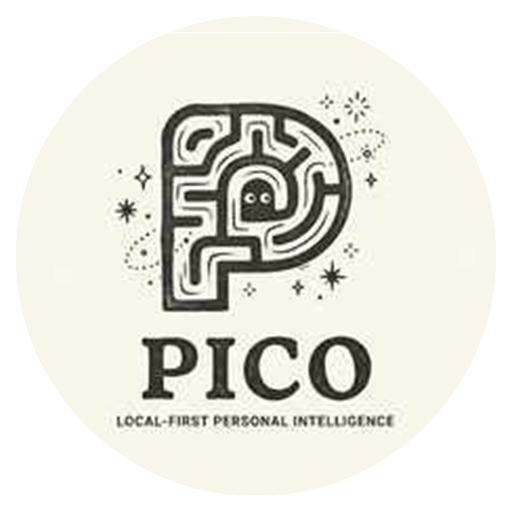

<p align="center">
  
</p>

# PICO — Personal Intelligence Coordinator & Operator

PICO is a local-first, privacy-first personal intelligence system engineered for verifiable persistence, private context compilation, transparent multi-model routing, and safe tool execution.

PICO is an orchestrated multi-component system—not a monolithic model or generic chatbot wrapper. It is engineered to coordinate knowledge, context, memory, tasks, and capability execution with policy-bounded autonomy and human authorization on your personal workstation.

---

## What is PICO?

PICO is **not** an all-knowing monolithic model, and it is **not** a thin wrapper around third-party chat APIs.

PICO **is** an orchestrated coordinator designed to operate reliably under strict workstation hardware constraints (Windows 11, Intel Core i5, 16 GB RAM, 4 GB dedicated GPU VRAM):

- **Deterministic Mock Provider by Default**: For reproducible offline development, testing, and continuous integration, PICO defaults to a deterministic `mock` provider (`DEFAULT_PROVIDER="mock"`), requiring zero external daemons or credentials.
- **Local Inference Support (`local-small`)**: When local inference is desired, PICO connects to Ollama running locally (`DEFAULT_PROVIDER="ollama"`) targeting the `local-small` profile (`qwen3.5:2b`), preserving privacy and operating fully offline. Multi-step autonomous planning for `local-small` is disabled by default (`WORKFLOW_SYNTHESIS_ENABLED=False`) and gated behind passing benchmark evaluations.
- **Selective Cloud Routing (`PUBLIC` Context Only)**: A configurable OpenAI-compatible cloud provider can be enabled for eligible `PUBLIC` context under explicit cloud opt-in (`CLOUD_ENABLED=true`). Sensitive, internal, secret, and unclassified context remains pinned locally (`RULE_PRIVATE_LOCAL_PIN`) with zero silent cloud fallback.
- **Four-Part Memory Subsystem**:
  - *Working Memory*: Bounded, session-scoped active context and task state.
  - *Episodic Memory*: Time-indexed historical event log, task execution outcomes, and reproducible errors.
  - *Semantic Memory*: Source-grounded facts and preferences searchable via SQLite FTS5 full-text indexing.
  - *Procedural Memory*: Reusable skills and workflow templates with strict draft, review, approval, and activation lifecycles.
- **Append-Only Event Ledger**: An immutable historical audit log of inputs, state transitions, tool executions, and model decisions enabling deterministic audit and recovery. (Synthesized, revisable knowledge lives in the Memory Service; immutable historical audit records live in the Event Ledger).
- **Permission-Controlled Capability Registry**: Tools are not arbitrary scripts; they are strictly typed, allowlisted capabilities governed by risk tiers (`READ_ONLY`, `MUTATION_REVERSIBLE`, `CONSEQUENTIAL`), Pydantic v2 schemas, and server-side authorization.
- **Policy & Approval Engine (Policy A)**: Consequential actions (file mutations, external communications, physical smart-home actuation) require explicit human operator approval via single-use CLI challenges and cryptographic input digests.
- **Sandboxed Execution Adapters**: Dedicated execution engines for host OS accessibility (`pico/os`), reversible filesystem operations (`pico/filesystem`), sandboxed browser navigation (`pico/browser`), and Home Assistant smart-home devices (`pico/homeassistant`).
- **Independent Verification**: PICO never assumes an action succeeded simply because a tool was invoked. Every consequential execution is independently verified against authoritative postcondition evidence (HTTP responses, DOM landing, device states) before success is reported.
- **Multi-Surface Experience Layer**: A polished desktop web command centre today (Phase 10), expanding to an expressive Windows desktop companion with animated eyes and local voice interaction in Milestone P11.

---

## How PICO Is Designed to Work: The 7-Step Interaction Lifecycle

PICO is designed around a disciplined, auditable request-to-execution pipeline for workflow-driven interactions. The architecture connects perception, context compilation, model reasoning, authorization, sandboxed execution, and independent verification:

```
[User Input] (Chat / Voice / Push-to-Talk)
     │
     ▼
1. Perception & Intent Formulation
     │
     ▼
2. Context Compilation & Classification (Tokens budgeted; PUBLIC / INTERNAL / SENSITIVE / SECRET)
     │
     ▼
3. Deterministic Model Routing (Local-small resident model; cloud only if PUBLIC + enabled)
     │
     ▼
4. Workflow Synthesis & Graph Validation (Typed DAG; Kahn acyclicity check; bound limits)
     │
     ▼
5. Policy & Approval Gate (Safe tools auto-dispatched; consequential actions pause for operator approval)
     │
     ▼
6. Sandboxed Capability Execution (Isolated adapters; atomic execution claims; reversible diffs)
     │
     ▼
7. Independent Verification & Spoken Feedback (Authoritative postcondition proof; immutable ledger audit)
```

1. **Perception & Ingestion**: Spoken input, typed messages, or desktop context enter PICO through clean perception adapters. *(Implemented today: typed chat and P6 audio session lifecycle with mock STT/TTS adapters. Planned for P11.3: embedded local Whisper STT, local TTS, and optional wake-word; planned for P11.5: contextual screen understanding).* Audio buffers and screen frames remain strictly transient in RAM and are never persisted or forwarded to external clouds.
2. **Context Compilation & Budgeting**: *(Implemented)* The Context Compiler selectively gathers relevant working, episodic, and semantic memories within a strict 4096-token ceiling. Data classification tags (`PUBLIC`, `INTERNAL`, `SENSITIVE`, `SECRET`) are computed with highest-classification inheritance.
3. **Deterministic Model Routing**: *(Implemented)* The Model Gateway routes requests based on sensitivity and task category. Requests containing `INTERNAL`, `SENSITIVE`, `SECRET`, or unclassified data are pinned strictly to local inference. Multi-step autonomous planning for `local-small` is gated behind passing benchmark evaluations.
4. **Workflow Synthesis & Graph Validation**: *(Implemented & hardware-gated)* Conversational task decomposition compiles unstructured user requests into reviewable `WorkflowDefinition` DAG proposals via `POST /api/workflows/synthesize` without granting execution authority. The P9 workflow engine validates graphs for acyclicity (Kahn's algorithm), verifies registered capability versions, checks input schemas, and enforces bounded execution limits (max 50 steps, max depth 20). Live synthesis is disabled by default (`WORKFLOW_SYNTHESIS_ENABLED=False`) and gated behind workstation hardware qualification (`pico_workflow_synthesis_v1`).
5. **Policy A Authorization & Approval Gate**: *(Implemented)* The LLM may propose plans, but can never authorize or approve them. Safe, read-only actions execute automatically; consequential actions pause in `awaiting_approval`, requiring human operator confirmation bound to a SHA-256 canonical input digest.
6. **Sandboxed Capability Execution**: *(Implemented)* Approved actions dispatch to isolated capability adapters (`os.*`, `filesystem.*`, `browser.*`, `homeassistant.*`, `memory.*`). Reversible operations generate compensation snapshots before mutating state.
7. **Independent Postcondition Verification**: *(Implemented verifier; spoken TTS feedback planned)* Multi-stage verifiers confirm actual outcome evidence (DOM elements, filesystem states, smart-home device attributes) before any success claim is emitted to the operator or spoken via local TTS.

---

## Core Engineering Principles

1. **Personal Intelligence System, Not a Chatbot**: Autonomous coordination of knowledge, context, memory, tasks, and tools without dilution into generic chatbot wrappers.
2. **Model-Provider Agnostic**: Provider-independent gateway interface (`StreamingResponse`, `StructuredOutput`, `ToolProposals`, `Metadata`). Switching providers never requires rewriting core logic.
3. **Local-First & Hardware Constrained**: Designed for Windows 11 on Intel Core i5-13420H, 16 GB RAM, and NVIDIA RTX 3050 (4 GB VRAM). Strict single-model residency in local inference runtimes; 4096-token budget ceiling.
4. **Selective Context with Provenance**: Prompts carry cryptographic provenance and data classification tags. Secrets (`APPROVAL_SECRET_TOKEN`, API keys) never reach models, browser bundles, or source control.
5. **Permission-Controlled & Verifiable Execution**: Model output is untrusted input. Tool execution is governed by explicit allowlists, JSON schema validation, idempotency tracking, and independent verification.
6. **Clear Separation Between Memory and Event Ledger**: Synthesized knowledge (subject to decay and pruning) lives in the Memory Service; immutable, append-only historical audit logs live in the Event Ledger.
7. **Consequential Actions Require Explicit Authorization**: Consequential actions halt for human approval via Policy A. Physical smart-home actuation enforces a server-side `APPROVAL_SECRET_TOKEN` configuration gate.
8. **Offline Resilience & Graceful Degradation**: Offline persistence, task management, and deterministic workflows remain fully functional during network or model provider outages. Zero auto-replay of ambiguous consequential mutations.

---

## Current Implementation vs. Canonical Roadmap

| Milestone | Subsystem | Scope & Capabilities | Status | Test Coverage |
| :--- | :--- | :--- | :--- | :--- |
| **P1** | Core Foundation & Gateway | FastAPI backend, SQLite WAL, model gateway (Mock, Ollama, Cloud), SSE chat streaming. | **VERIFIED** | Unit & integration tests |
| **P2** | Relational Data Model | Conversations, messages, projects, tasks, routing decisions, Alembic migrations. | **VERIFIED** | DB schema tests |
| **P3** | Memory Subsystem | Four-part memory (Working, Episodic time-indexed, Semantic FTS5, Procedural), decay/pruning. | **VERIFIED** | Memory service tests |
| **P4** | Context Compilation | Context compiler, classification budgeting (`PUBLIC` to `SECRET`), `RULE_PRIVATE_LOCAL_PIN`. | **VERIFIED** | Compiler tests |
| **P5** | Tool Execution Engine | Capability registry, risk tiers (`READ_ONLY`, `MUTATION_REVERSIBLE`, `CONSEQUENTIAL`), allowlist. | **VERIFIED** | Execution engine tests |
| **P6** | Multimodal Perception | Audio session lifecycle (`AudioSessionManager`), mock STT/TTS adapters, visual mic states. | **VERIFIED** | Audio & perception tests |
| **P7** | Home Assistant Integration | Read-only smart-home discovery, single test light actuation (`P7.3`), triple-digest gate. | **VERIFIED** | Home Assistant tests |
| **P8** | Desktop & OS Automation | Host accessibility (`pico/os`), staged filesystem diffs (`pico/filesystem`), Playwright browser (`pico/browser`). | **VERIFIED** | OS, FS, browser tests |
| **P9** | Workflow Orchestration | Typed DAG engine (`WorkflowService`), Kahn acyclicity check, Stages A–D verifier, compensations. | **VERIFIED** | Workflow engine tests |
| **P10.1** | Desktop Web Command Centre | Polished local-first React + Vite UI, streaming chat, timeline, memory, approval inbox. | **VERIFIED** | 125 Vitest tests |
| **P10.2** | Offline Shell & Safe Recovery | Service worker offline shell, in-memory draft outbox, ambiguous outcome tagging, session revalidation. | **VERIFIED** | Resilience tests |
| **P10.3** | Operator Authorization Closure | Policy A pairing challenge CLI, mandatory physical actuation token gate, standalone dispatch. | **VERIFIED** | 795 backend / 139 UI tests |
| **P11.1** | Conversational Workflow Synthesis | Natural language intent extraction to validated DAGs, benchmark gating for `local-small`. | **MERGED (Hardware Qualification Pending)** | 72 synthesis / 108 workflow tests |
| **P11.2** | Windows Desktop Companion Shell | Native desktop shell (Tauri 2 + Rust), frameless window, system tray foundation, secure loopback bridge. | **ACTIVE (P11.2.1 Shell In Review)** | [ADR 0001](docs/decisions/0001-windows-desktop-companion-architecture.md) / 141 UI tests |
| **P11.3** | Local Voice Runtime & Wake-Word | Embedded Whisper STT, local Piper/SAPI TTS, push-to-talk, optional on-device wake-word. | **PLANNED** | Roadmap defined |
| **P11.4** | Voice-to-Action Integration | Spoken intent to verified workflow execution, consequential action gating, TTS feedback. | **PLANNED** | Roadmap defined |
| **P11.5** | Contextual Screen Understanding | On-demand screen capture, untrusted visual input boundary, ephemeral RAM-only frames. | **PLANNED** | Roadmap defined |

---

## Architecture & Documentation

- [AGENTS.md](AGENTS.md) — Non-negotiable operating rules, hardware constraints, and engineering principles.
- [docs/architecture.md](docs/architecture.md) — System architecture, subsystem boundaries, data flows, and P11 companion specifications.
- [docs/data-model.md](docs/data-model.md) — Relational persistence models, SQLite WAL configuration, and schema evolution.
- [docs/api-contract.md](docs/api-contract.md) — REST API endpoints, schemas, validation envelopes, and Policy A contracts.
- [docs/security-and-risk-register.md](docs/security-and-risk-register.md) — Threat modeling, local trust boundaries, and risk mitigations.
- [docs/implementation-plan.md](docs/implementation-plan.md) — Phased delivery plan, verification evidence, and P11 milestone tasks.
- [docs/evaluation/README.md](docs/evaluation/README.md) — Evaluation framework, representative test cases, and quality benchmarks.
- [docs/model-gateway-design.md](docs/model-gateway-design.md) — Per-step model router, profiles, and data classification policies.

---

## Local Setup & Quickstart (Windows PowerShell)

### 1. Prerequisites
- **Python**: 3.12+ (tested across Python 3.12, 3.13, and 3.14 on Windows 11).
- **Node.js**: 22+ (LTS recommended) and **pnpm** 10+ (`npm install -g pnpm` or `winget install pnpm`).
- **Rust**: Stable Rust toolchain (`rustup`) with MSVC C++ Build Tools and Windows 11 SDK (required for compiling the native desktop shell).
- **Microsoft Edge WebView2**: Pre-installed on Windows 11 (required desktop runtime).
- **PowerShell**: Windows PowerShell 5.1+ or PowerShell 7+.
- **Ollama** (optional for live local inference): https://ollama.ai with `qwen3.5:2b`.

### 2. Environment Activation & Dependencies
```powershell
# Create virtual environment (if not already created)
python -m venv .venv

# Activate virtual environment
.\.venv\Scripts\Activate.ps1

# Install pinned backend dependencies
pip install -r requirements.txt
```

### 3. Database Migrations & Seeding
```powershell
# Apply Alembic schema migrations (conversations, messages, projects, tasks, routing_decisions, operator_pairing_challenges)
alembic upgrade head

# (Optional) Seed deterministic local development data
python -m pico.db.seed
```

### 4. Run Backend Server
```powershell
uvicorn pico.main:app --host 127.0.0.1 --port 8000 --reload
```
Once running:
- **Interactive OpenAPI Documentation**: `http://127.0.0.1:8000/docs`
- **Health Check**: `http://127.0.0.1:8000/health`
- **Desktop Web UI** (when built): `http://127.0.0.1:8000/`

---

## Desktop Web Experience (Phase 10)

PICO ships a local-first desktop UI in `frontend/`. It connects directly to the FastAPI backend over loopback and provides streaming chat, workflow timelines, memory inspection, approval handling, and system status in one unified command centre.

### Development Mode (Hot-Reload with Backend Proxy)
```powershell
# 1. Start the FastAPI backend first (see above)
uvicorn pico.main:app --host 127.0.0.1 --port 8000 --reload

# 2. In a second terminal, install frontend dependencies and start Vite dev server
cd frontend
pnpm install
pnpm run dev
# Opens http://localhost:5173 with proxy to http://127.0.0.1:8000
```

### Production Build (Served Directly by FastAPI)
```powershell
# Install frontend dependencies once
pnpm --dir frontend install

# Build static bundle to frontend/dist/
pnpm --dir frontend run build

# FastAPI automatically serves frontend/dist when dist/assets/ exists
uvicorn pico.main:app --host 127.0.0.1 --port 8000
# Open http://127.0.0.1:8000/
```

### Frontend Verification Suite
Verification commands are runnable directly from the repository root:
```powershell
pnpm --dir frontend run test        # Vitest — all 141 unit, integration, and desktop shell tests
pnpm --dir frontend run typecheck   # TypeScript strict type checking
pnpm --dir frontend run build       # Production bundle build
```

---

## Windows Desktop Companion Shell (Milestone P11.2)

PICO provides a native Windows desktop companion application built with **Tauri 2** and **Rust** in `frontend/src-tauri/`. It hosts the local-first React command centre inside an OS-level frameless, rounded desktop window with native Windows system tray integration.

### Desktop Shell Capabilities (P11.2.1 Foundation)
- **Frameless Window Management**: Frameless window with standard window dragging via the application header, custom minimize and close controls, and background click-through prevention.
- **Native Windows System Tray**: Always-accessible tray icon with a 5-item menu (`Status: Offline`, `Open PICO`, `Pause Perception`, `Settings`, `Quit PICO`).
- **Close-to-Tray Lifecycle**: Clicking the window close button intercepts the event (`api.prevent_close()`) and hides the window to the tray rather than terminating the process. Clicking the tray icon or selecting "Open PICO" restores and focuses the window.
- **Strict Isolation & Invariant 12**: The desktop shell is strictly an interaction surface. It never introduces an independent LLM reasoning loop, duplicate memory store, or private execution backchannel.

### Desktop Shell Development Mode
```powershell
# 1. Start the FastAPI backend
uvicorn pico.main:app --host 127.0.0.1 --port 8000 --reload

# 2. Start Tauri in development mode (launches Vite dev server on port 1420 and native window)
pnpm --dir frontend run tauri:dev
```

### Desktop Shell Build (Headless / No-Bundle)
```powershell
# Build the native Windows desktop binary without generating installer bundles
pnpm --dir frontend run tauri:build -- --no-bundle
```
*(Note: MSI and NSIS installer packaging, auto-start registry integration, and process-tree memory qualification are explicitly scheduled for Milestone P11.2.4).*

---

## Policy A Operator Authorization & Pairing

Consequential operations (tool executions, approvals, compensations, and physical actuation) require verified authorization under Policy A. The backend strictly distinguishes between local interactive callers and remote/headless callers:

### 1. Local Desktop & Browser Caller (Paired Operator Session)
Local interactive clients on loopback (`127.0.0.1` / `localhost`) authorize consequential operations by establishing a paired operator session:
- A human operator generates a single-use 6-digit challenge via the CLI:
  ```powershell
  # In a separate terminal with backend running, generate pairing challenge:
  python -m pico.cli.pair

  # Representative output (sample values for illustration):
  # ==================================================
  #  PICO Local Operator Pairing Code
  # ==================================================
  #  Pairing Code : 482910
  #  Approver     : local_operator
  #  Expires At   : 2026-11-01T23:45:00.000000+00:00 UTC
  #  Valid for    : 300 seconds
  # ==================================================
  # Enter this 6-digit code in the PICO web interface to pair your session.
  # ==================================================
  ```
- The operator enters the 6-digit code into the UI pairing modal.
- Challenges are persisted in SQLite (`operator_pairing_challenges`), salt-hashed, expire in 300 seconds, and lock out after 5 consecutive failures.
- Browser-side code minting is strictly prohibited; the approver identity (`local_operator`) is bound to the challenge at CLI creation.
- Upon successful verification, the backend issues an `HttpOnly; SameSite=Strict` cookie (`pico_operator_session`) and returns a session-bound CSRF token in JSON. Mutating requests require the matching `X-CSRF-Token` header.
- **The browser never receives or stores `APPROVAL_SECRET_TOKEN`.**

### 2. Remote or Headless Caller (Approval Token Path)
Remote systems or headless automation authorize consequential operations using the `X-Pico-Approval-Token` header:
- The token must match the server-side `APPROVAL_SECRET_TOKEN` configuration.
- Tokens are compared in constant time over UTF-8 bytes (`secrets.compare_digest`), failing closed on missing, malformed, or mismatched credentials.
- Remote callers presenting only a browser operator-session cookie are strictly rejected.
- When using the token path, loopback callers are not exempt from token validation.

### 3. Physical Home Assistant Actuation Configuration Gate
Physical Home Assistant dispatch (`homeassistant.test_light_actuate`) fails closed unless the server-side `APPROVAL_SECRET_TOKEN` is explicitly configured. A valid paired local session can create and approve the proposal, but it does not waive this dispatch gate:
1. A valid paired local operator session can authorize creation of a consequential proposal (`POST /api/homeassistant/actuation/propose`).
2. The proposal is created in `awaiting_approval` status bound to a SHA-256 digest.
3. The paired local operator may approve the proposal using the existing Policy A flow (`POST /api/operator/approvals/{approval_id}`).
4. The server-side `APPROVAL_SECRET_TOKEN` configuration gate is independently enforced before physical dispatch.
5. Without that server-side configuration, physical dispatch fails closed with an authorization error.
6. A valid paired local session does not waive the physical-dispatch configuration gate.

### UI Authorization & Operator States
The PICO desktop interface distinguishes six operator and action states:
1. **Unpaired / Read-Only**: Inspect conversation history, view active workflows, search memories, and run safe non-consequential tools.
2. **Pairing Required**: Consequential action proposals halt in `awaiting_approval`; approval buttons in the Approval Inbox remain locked until an operator pairs via the CLI.
3. **Authenticated Operator Session**: A verified operator session exists. Consequential actions can be reviewed and approved by the human operator using the cryptographic digest.
4. **Expired or Revoked Session**: The session has expired or was revoked via logout; approval actions re-lock until a new CLI code is paired.
5. **Unauthorized Action**: A client or workflow step requested a privileged capability without possessing the required capability permissions; execution fails closed with zero side effects.
6. **Authorized Pending Approval**: A consequential capability step is authorized to run once approved by the human operator, bound to the SHA-256 canonical input digest.

---

## Offline Resilience & Safe Recovery

PICO's desktop shell and recovery architecture are engineered to withstand backend disconnections, inference failures, and interrupted streams without leaking private data or causing duplicate side effects.

1. **Application Shell & Caching**:
   - The service worker (`sw.js`) caches only the static application shell (`/`, `/index.html`) and immutable build bundles (`/assets/*`).
   - In adherence to PICO's local-first privacy rules, the service worker and browser persistent storage (`localStorage`, `sessionStorage`, `IndexedDB`) strictly **never** cache private conversations, messages, drafts, memory records, execution logs, pairing tokens, or approval tickets.
   - All `/api/*` endpoints bypass the service worker cache entirely. Failed calls return genuine network errors rather than falling back to SPA HTML.
2. **In-Memory Draft Outbox (Zero Auto-Submit)**:
   - If a message cannot be dispatched due to backend unavailability, it is preserved in an in-memory draft queue (bounded to 25 items).
   - Drafts are **never automatically transmitted** upon reconnection. Users review, edit, discard, or explicitly send pending drafts once connectivity is restored.
   - Drafts reside strictly in active application memory; refreshing or closing the browser window discards them, preventing unencrypted persistence on disk.
3. **Ambiguous Outcomes & Zero Auto-Replay**:
   - Interrupted SSE chat streams are visibly tagged as `[Response stream interrupted]` and marked with an ambiguous outcome notice. They are never marked as completed, and requests are never automatically retried.
   - Consequential mutations (approvals, tool dispatches, workflow advances, compensations) with ambiguous network outcomes are marked **"Outcome unknown"**. The UI never performs blind retries.
4. **Operator Session Revalidation on Reconnect**:
   - When the backend recovers from an offline state, the frontend immediately revalidates the operator session against `GET /api/operator/session`.
   - Consequential approval controls remain locked in `pairing_required` until the backend confirms that the session cookie and CSRF token remain valid.

---

## Model Providers & Streaming Chat

PICO features a provider-agnostic model gateway with per-step deterministic routing.

### 1. Exercise Streaming Chat with Development Mock (Default)
The system defaults to a deterministic, offline `mock` provider (`DEFAULT_PROVIDER="mock"`) requiring no external runtimes or credentials:
```powershell
# Create a conversation and invoke streaming chat in PowerShell
$conv = Invoke-RestMethod -Uri "http://127.0.0.1:8000/api/conversations" -Method Post -ContentType "application/json" -Body '{"title": "Demo Thread"}'

$body = @{
    conversation_id = $conv.id
    message = "Explain PICO local persistence."
    data_classification = "INTERNAL"
} | ConvertTo-Json

Invoke-RestMethod -Uri "http://127.0.0.1:8000/api/chat/stream" -Method Post -ContentType "application/json" -Body $body
```

### 2. Connect to Local Ollama Inference (Supported Local Profile)
To enable live local inference with Ollama:
```powershell
# 1. Verify Ollama is running on localhost
curl.exe -s http://127.0.0.1:11434/api/tags

# 2. Verify qwen3.5:2b is installed (PICO never downloads models automatically)
# If missing, pull manually outside PICO: ollama pull qwen3.5:2b

# 3. Configure PICO to use Ollama in .env or PowerShell session
$env:DEFAULT_PROVIDER = "ollama"
$env:OLLAMA_MODEL = "qwen3.5:2b"
```

### 3. Explicit Cloud Opt-In (PUBLIC Data Only)
Cloud inference is strictly disabled by default (`CLOUD_ENABLED=false`). Private and secret data never leaves the machine. To explicitly enable cloud inference for `PUBLIC` data using a configurable OpenAI-compatible cloud provider:
```powershell
# Enable cloud access in .env or session
$env:CLOUD_ENABLED = "true"
$env:CLOUD_BASE_URL = "https://api.openai.com/v1"
$env:CLOUD_MODEL = "gpt-4o-mini"
$env:CLOUD_API_KEY = "sk-..."  # Your private API key
```

> [!IMPORTANT]
> Any prompt marked `INTERNAL`, `SENSITIVE`, `SECRET`, or unclassified will remain pinned to local inference even if cloud is enabled. There is no silent cloud fallback.

---

## Local Hardware Benchmarking (`tools/bench/`)

PICO includes a local benchmark runner to measure model readiness and system resource consumption (TTFT, tokens/sec, RAM, GPU VRAM) under the Windows target hardware baseline.

### 1. Check Ollama Availability & Installed Models
```powershell
curl.exe -s http://127.0.0.1:11434/api/tags
ollama list
```

### 2. Run Mock Benchmark (Offline Tooling Path)
```powershell
.\.venv\Scripts\python.exe -m tools.bench.runner --mock --repetitions 3 --output-dir bench_reports
```
> [!NOTE]
> A successful `--mock` test run exercises the runner tooling only and must **never** be cited as a completed hardware evaluation.

### 3. Run Live Hardware Benchmark
```powershell
# Run 3 measured iterations (+ 1 warmup run)
.\.venv\Scripts\python.exe -m tools.bench.runner --model qwen3.5:2b --repetitions 3 --output-dir bench_reports

# Run with custom repetitions and context size
.\.venv\Scripts\python.exe -m tools.bench.runner --model qwen3.5:2b --repetitions 5 --context-size 4096 --max-tokens 128

# Run with quality gate thresholds (e.g. minimum 15 tok/s, max 1200ms TTFT)
.\.venv\Scripts\python.exe -m tools.bench.runner --model qwen3.5:2b --repetitions 3 --min-tokens-per-sec 15.0 --max-ttft-ms 1200.0
```

### 4. Reading Benchmark Reports
Benchmark reports are saved to the specified output directory (default: `bench_reports/`):
- **File format**: `bench_<model>_YYYYMMDD_HHMMSS.md` (Markdown summary) and `bench_<model>_YYYYMMDD_HHMMSS.json` (machine-readable data).
- **Filename Collision Limitation**: Filenames use UTC timestamps with second-level resolution (`%Y%m%d_%H%M%S`). While each report contains a unique internal `benchmark_id`, executing multiple benchmark runs for the same model within the same second will overwrite existing report files. To prevent collisions, avoid running simultaneous benchmarks for the same model against the same directory, or specify distinct directories using `--output-dir`.

---

## Safe Local Automation Scripts (`scripts/`)

PICO provides safe, repeatable PowerShell automation scripts under `scripts/` to validate runtimes, inspect host hardware, run development verification checks, and execute benchmarks with strict safety invariants (no automatic downloads, no silent cloud routing, and strictly opt-in service startup).

### 1. Local Runtime Preflight (`scripts/pico-preflight.ps1`)
Verifies that local prerequisites are met prior to running live inference:
```powershell
# Run preflight verification in live mode
.\scripts\pico-preflight.ps1

# Run preflight verification targeting a specific model
.\scripts\pico-preflight.ps1 -Model "qwen3.5:2b"

# Run preflight verification in simulated mock mode (offline testing)
.\scripts\pico-preflight.ps1 -Mock

# Explicitly opt in to starting Ollama if not running (does not download models)
.\scripts\pico-preflight.ps1 -StartOllama
```

### 2. Development Verification Pipeline (`scripts/pico-verify.ps1`)
Runs the continuous integration verification gate locally without committing, pushing, or discarding any working tree changes:
1. **Python Bytecode Compilation**: Runs `python -m compileall -q pico tests tools` to ensure zero syntax errors across the workspace.
2. **Git Whitespace & Marker Integrity**: Runs `git diff --check` to catch conflict markers and trailing whitespace errors.
3. **Automated Test Suite**: Executes `pytest -v` across all unit, integration, and security test suites.

```powershell
# Run full development verification (compilation, git diff check, and all tests)
powershell -ExecutionPolicy Bypass -File .\scripts\pico-verify.ps1

# Run fast verification (compilation and git check only, skipping test execution)
powershell -ExecutionPolicy Bypass -File .\scripts\pico-verify.ps1 -SkipTests
```

### 3. Safe Benchmark Wrapper (`scripts/pico-benchmark.ps1`)
```powershell
# Run offline simulated benchmark
.\scripts\pico-benchmark.ps1 -Mock -Repetitions 3

# Run live hardware benchmark on local Ollama (requires preflight pass)
.\scripts\pico-benchmark.ps1 -Model "qwen3.5:2b" -Repetitions 3
```

---

## Home Assistant Integration (Milestones P7.1, P7.2 & P7.3)

PICO integrates with Home Assistant as a local smart-home hub for situational awareness and bounded, verified physical actuation:
- **Strictly Disabled by Default**:
  - Read-Only: Set `HOME_ASSISTANT_ENABLED=true`, `HOME_ASSISTANT_BASE_URL`, and `HOME_ASSISTANT_ACCESS_TOKEN` in `.env` to enable read-only discovery.
  - Physical Actuation: Set `HOME_ASSISTANT_ACTUATION_ENABLED=true` and `HOME_ASSISTANT_P7_TEST_LIGHT_ENTITY_ID` (must be a single entity in the `light` domain).
- **REST & WebSocket Clients (Stage A Read-Only Awareness)**:
  - `GET /api/homeassistant/status` — Inspect integration health and connection state.
  - `GET /api/homeassistant/entities` — Discover entities and reported states with sanitized attributes.
  - `GET /api/homeassistant/entities/{entity_id}` — Read-only inspection of one specific entity and its sanitized state.
  - `GET /api/homeassistant/overview` — Bounded smart-home summary for assistant awareness.
  - WebSocket command allowlist strictly enforced: `get_states`, `get_config`, `ping`. Zero mutation over WebSocket.
- **Verified Physical Action (Milestone P7.3 Single Test Light)**:
  - `POST /api/homeassistant/actuation/plan` — Strictly read-only planning endpoint to inspect proposed actuation without side effects.
  - `POST /api/homeassistant/actuation/propose` — Proposes an actuation execution requiring valid Policy A authorization (paired operator session or approval token).
  - `GET /api/homeassistant/actuation/{execution_id}` — Inspects actuation execution status and verification proof.
  - Dedicated capability `homeassistant.test_light_actuate` with risk tier `HIGH` and `consequential=True`.
- **Fail-Closed Physical Actuation Guardrails**:
  - **Single Entity & Actions**: Only controls `HOME_ASSISTANT_P7_TEST_LIGHT_ENTITY_ID` with `turn_on` or `turn_off`. Any other entity or action fails closed.
  - **Policy A Authorization & Dispatch Gate**: Proposal and approval require valid Policy A authorization (paired local operator session or `X-Pico-Approval-Token`). Physical dispatch additionally requires a non-empty server-side `APPROVAL_SECRET_TOKEN`; a paired loopback session does not waive this configuration gate.
  - **Dedicated Permission**: Requires `homeassistant:actuate`, strictly excluded from generic default tool permissions.
  - **Triple-Digest Integrity**: Persisted input recomputed SHA-256 == stored execution digest == approval bound digest verified immediately before mutation dispatch.
  - **Single-Use Replay Protection**: Approvals are single-use; duplicate or replayed dispatches fail closed with `AuthorizationError`.
  - **Zero Blind Retries**: Independent read-after-write verification polling via read-only state API; never automatically retries a mutation on timeout or failure.
  - **Trusted Privacy Gate**: Household data defaults to `INTERNAL` (or `SENSITIVE` for locks, alarms, and cameras); never sent to cloud models.

---

## Troubleshooting & Common Failures

- **`BENCHMARK BLOCKED`**:
  - Cause: Ollama is unreachable at `http://127.0.0.1:11434` or the requested model is missing.
  - Fix: Start Ollama desktop or run `ollama serve`. If the model is missing, run `ollama run qwen3.5:2b`.
- **`PROVIDER_CONNECTION_ERROR` (503)**:
  - Cause: Ollama is selected (`DEFAULT_PROVIDER=ollama`) but the Ollama daemon is not running.
  - Fix: Start Ollama desktop or run `ollama serve` (or run `.\scripts\pico-preflight.ps1 -StartOllama`).
- **`PROVIDER_MODEL_NOT_FOUND` (404)**:
  - Cause: Ollama is running but `qwen3.5:2b` has not been pulled.
  - Fix: Run `ollama pull qwen3.5:2b` manually. PICO will never trigger automatic background model downloads.
- **`PROVIDER_CONFIG_ERROR` (503)**:
  - Cause: Cloud profile was requested or routed, but `CLOUD_ENABLED` is false or `CLOUD_API_KEY` is missing.
  - Fix: Enable cloud explicitly via `CLOUD_ENABLED=true` and provide `CLOUD_API_KEY`.
- **`FOREIGN KEY constraint failed` (404/422)**:
  - Cause: Message or task created with a non-existent conversation or project ID.
  - Fix: Create parent conversation or project first.

---

## Automated Verification & Test Commands

Run the full automated test suite (offline, zero external network calls):
```powershell
# Run backend pytest suite (795 tests across all subsystems)
.\.venv\Scripts\pytest.exe

# Run frontend test suite (139 tests: SSE parser, chat, voice, memory, workflows, approvals, connectivity, resilience, offline shell, standalone execution lifecycle, workflow synthesis review)
pnpm --dir frontend run test
pnpm --dir frontend run typecheck
pnpm --dir frontend run build

# Comprehensive verification script (executes compilation, git diff check, and all backend tests)
powershell -ExecutionPolicy Bypass -File .\scripts\pico-verify.ps1
```
All tests execute using deterministic mock transports, synthetic OS/filesystem/browser adapters, and isolated temporary SQLite databases.
