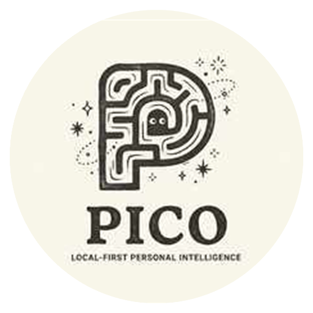

<p align="center">
  
</p>

# PICO — Personal Intelligence Coordinator & Operator

[](LICENSE)
[](https://github.com/Lurkaee/PICO/actions/workflows/ci.yml)

PICO is a local-first, privacy-first personal intelligence system engineered for verifiable persistence, private context compilation, transparent multi-model routing, and safe tool execution.

PICO is an orchestrated multi-component system — **not** a monolithic model, and **not** a generic chatbot wrapper. It coordinates knowledge, context, memory, tasks, and capability execution with policy-bounded autonomy and human authorization on your personal workstation.

---

## 1. What is PICO?

PICO is **not** an all-knowing monolithic model, and it is **not** a thin wrapper around third-party chat APIs.

PICO **is** an orchestrated coordinator designed to operate reliably under strict workstation hardware constraints (Windows 11, Intel Core i5, 16 GB RAM, 4 GB dedicated GPU VRAM):

- **Deterministic Mock Provider by Default**: For reproducible offline development, testing, and continuous integration, PICO defaults to a deterministic `mock` provider (`DEFAULT_PROVIDER="mock"`), requiring zero external daemons or credentials.
- **Local Inference Support (`local-small`)**: When local inference is desired, PICO connects to Ollama running locally (`DEFAULT_PROVIDER="ollama"`) targeting the `local-small` profile (`qwen3.5:2b`), preserving privacy and operating fully offline. Multi-step autonomous planning for `local-small` is disabled by default (`WORKFLOW_SYNTHESIS_ENABLED=False`) and gated behind passing benchmark evaluations.
- **Selective Cloud Routing (`PUBLIC` Context Only)**: A configurable OpenAI-compatible cloud provider can be enabled for eligible `PUBLIC` context under explicit cloud opt-in (`CLOUD_ENABLED=true`). Sensitive, internal, secret, and unclassified context remains pinned locally (`RULE_PRIVATE_LOCAL_PIN`) with zero silent cloud fallback.
- **Four-Part Memory Subsystem**:
  - *Working Memory*: Bounded, session-scoped active context and task state.
  - *Episodic Memory*: Time-indexed historical event log, task execution outcomes, and reproducible errors.
  - *Semantic Memory*: Source-grounded facts and preferences searchable via SQLite FTS5 full-text indexing.
  - *Procedural Memory*: Reusable skills and workflow templates with strict draft, review, approval, and activation lifecycles.
- **Append-Only Event Ledger**: An immutable historical audit log of inputs, state transitions, tool executions, and model decisions enabling deterministic audit and recovery. (Synthesized, revisable knowledge lives in the Memory Service; immutable historical audit records live in the Event Ledger).
- **Permission-Controlled Capability Registry**: Tools are not arbitrary scripts; they are strictly typed, allowlisted capabilities governed by risk tiers (`READ_ONLY`, `MUTATION_REVERSIBLE`, `CONSEQUENTIAL`), Pydantic v2 schemas, and server-side authorization.
- **Policy & Approval Engine (Policy A)**: Consequential actions (file mutations, external communications, physical smart-home actuation) require explicit human operator approval via single-use CLI challenges and cryptographic input digests.
- **Sandboxed Execution Adapters**: Dedicated execution engines for host OS accessibility (`pico/os`), reversible filesystem operations (`pico/filesystem`), sandboxed browser navigation (`pico/browser`), and Home Assistant smart-home devices (`pico/homeassistant`).
- **Independent Verification**: PICO never assumes an action succeeded simply because a tool was invoked. Every consequential execution is independently verified against authoritative postcondition evidence (HTTP responses, DOM landing, device states) before success is reported.
- **Multi-Surface Experience Layer**: A polished desktop web command centre (Phase 10), complemented by an expressive native Windows desktop companion with animated eyes and authenticated loopback IPC bridge (Milestone P11.2; local voice interaction is under active qualification in Milestone P11.3).

---

## 2. Core Architecture & Design Philosophy

PICO operates on six core architectural invariants:

1. **Classification Before Invocation:** Effective context is classified during compilation — considering user input, history, memory, retrieval, and tool outputs — before any model provider is selected or called.
2. **Local Pinning of Non-Public Data:** Any context classified as `INTERNAL`, `SENSITIVE`, or `SECRET` must remain local. Cloud providers may receive only explicitly `PUBLIC` effective context.
3. **No Silent Privacy Downgrades:** Local data cannot be converted to `PUBLIC` through transformations, summarization, or context manipulation.
4. **Fail-Closed Provider Gate:** If classification fails, context sensitivity is unknown, or cloud credentials are missing, the gateway defaults to local execution or halts closed with a `PrivacyViolationError`.
5. **Human In The Loop (Policy A):** Models propose actions; humans authorize consequential operations. Untrusted model output cannot grant permissions or approve its own tools.
6. **Independent Postcondition Verification:** Actions report success only when corroborated by verified external evidence, never by tool return values alone.

### Request-to-Execution Lifecycle (7 Stages)

```
[User Input] (Chat / Voice Push-to-Talk)
     │
     ▼
1. Perception & Intent Formulation
     │
     ▼
2. Context Compilation & Classification (Tokens budgeted; PUBLIC / INTERNAL / SENSITIVE / SECRET)
     │
     ▼
3. Deterministic Model Routing (Local resident model; Cloud ONLY if PUBLIC + CLOUD_ENABLED)
     │
     ▼
4. Workflow Synthesis & Graph Validation (Typed DAG; Kahn acyclicity check; bound limits)
     │
     ▼
5. Policy & Approval Gate (Safe tools auto-dispatched; consequential actions pause for operator approval)
     │
     ▼
6. Sandboxed Capability Execution (Host OS, staged filesystem diffs, Playwright browser, Home Assistant)
     │
     ▼
7. Independent Verification & Memory Ingestion (Authoritative evidence checked; outcomes recorded)
```

---

## 3. Actual Implementation Status

The table below reflects verified repository reality. Distinguish operational features from those under qualification or planned on the roadmap:

| Phase / Slice | Subsystem | Status | Operational Capabilities | Automated Verification |
| :--- | :--- | :--- | :--- | :--- |
| **P0 / B1** | Core Persistence & Gateway Baseline | **IMPLEMENTED** | SQLite WAL, relational models, Alembic migrations, think-behavior precedence. | `tests/test_db_persistence.py`, `tests/test_ollama_provider.py` |
| **P1** | Central Privacy Gate | **IMPLEMENTED** | Classification hierarchy (`SECRET` > `SENSITIVE` > `INTERNAL` > `PUBLIC`), `RULE_PRIVATE_LOCAL_PIN`, fail-closed routing. | `tests/test_routing_service.py`, `tests/test_cloud_provider.py` |
| **P2 / P4** | Context Compiler v0 | **IMPLEMENTED** | Conservative token budgeting (`max_prompt_budget` = 3328 / 4096), ChatML & OpenAI framing overhead accounting. | `tests/test_context_compiler.py` (22 tests) |
| **P3** | Four-Part Memory Subsystem | **IMPLEMENTED** | Working memory, Episodic time-indexed log, Semantic FTS5 full-text search, Procedural skills state machine. | `tests/test_memory_api.py`, `tests/test_memory_service.py` |
| **P5** | Capability Registry | **IMPLEMENTED** | Typed allowlisted tools, risk tiers (`READ_ONLY`, `MUTATION_REVERSIBLE`, `CONSEQUENTIAL`), Pydantic v2 validation. | `tests/test_capability_registry.py` |
| **P6** | Multimodal Audio Perception | **IMPLEMENTED** | Local `AudioSessionManager` lifecycle, mock STT/TTS adapters, visual microphone states, fail-closed audio validation. | `tests/test_audio_session_lifecycle.py` |
| **P7** | Home Assistant Integration | **IMPLEMENTED** | Read-only entity discovery, single test light actuation (P7.3), allowlisted climate planning/actuation (P7.4). | `tests/test_homeassistant_*.py` (48 tests) |
| **P8** | OS, Filesystem & Browser Automation | **IMPLEMENTED** | Accessible OS automation, staged filesystem diffs within project root, Playwright sandboxed browser with origin allowlists. | `tests/test_os_automation.py`, `tests/test_filesystem_*.py` |
| **P9** | Autonomous Workflow Orchestration | **IMPLEMENTED** | Typed DAG execution engine, Kahn acyclicity verification, Stage A–D verifiers, compensation handlers, independent verification. | `tests/test_workflow_coordination.py` (18 tests), `tests/test_resource_scheduler.py` (16 tests), `tests/test_workflow_verification.py` (13 tests) |
| **P10.1** | Desktop Web Command Centre | **IMPLEMENTED** | Local-first React 19 + Vite 8 UI, streaming SSE chat, execution timeline, memory inspector, approval inbox. | 125 Vitest tests in `frontend/src/__tests__/` |
| **P10.2** | Offline Shell & Safe Recovery | **IMPLEMENTED** | Service worker offline shell, in-memory draft outbox, ambiguous outcome tagging, session revalidation. | `frontend/src/__tests__/resilience.test.tsx` |
| **P10.3** | Operator Authorization Closure | **IMPLEMENTED** | Policy A pairing challenge CLI, mandatory physical actuation token gate, standalone dispatch lifecycle. | `tests/test_operator_pairing.py`, `frontend/src/__tests__/approvals.test.tsx` |
| **P11.1** | Conversational Workflow Synthesis | **IMPLEMENTED** | Natural language intent extraction to validated DAGs; planning gated behind benchmark evaluation on `local-small`. | `tests/test_workflow_synthesis.py` (72 tests) |
| **P11.2** | Windows Desktop Companion Shell | **IMPLEMENTED** | Native Tauri 2 + Rust companion shell, authenticated loopback IPC bridge, NSIS packaging isolation, expressive animated eyes (P11.2.4.3). | `frontend/src-tauri/`, `tests/test_bridge_proof.py` |
| **P11.3** | Local Voice Runtime & STT Pipeline | **IN PROGRESS** | Audio capture abstraction & WAV validation complete (P11.3.1); native whisper.cpp prototype built (P11.3.2); hardware qualification underway. | `tests/test_voice_runtime_slice.py`, `docs/evaluation/voice-qualification-results.md` |
| **P11.4** | End-to-End Multimodal Task Actuation | **IN PROGRESS** | Voice command routing to DAG synthesis and capability actuation. | Roadmap specification in `docs/implementation-plan.md` |
| **P11.5** | Contextual Desktop Perception | **IN PROGRESS** | On-demand screen capture, ephemeral zero-retention RAM frames, untrusted data boundary. | Architectural specification draft in `docs/decisions/0007-p11-5-contextual-desktop-perception-architecture.md` |

For exact milestone status, active branches, PR mappings, and dependencies, see [docs/PROJECT_STATE.md](docs/PROJECT_STATE.md).

---

## 4. Repository Component Map

```text
PICO/
├── pico/                              # Core Python backend package
│   ├── api/                           # FastAPI route controllers (chat, memory, workflows, companion, pairing)
│   ├── capabilities/                  # Registered allowlisted capabilities (core, os, fs, browser, homeassistant)
│   ├── core/                          # Settings (config.py), error definitions, process supervisor
│   ├── db/                            # SQLite database engine, WAL configuration, transactional session scope
│   ├── models/                        # SQLAlchemy relational models (conversations, messages, memory, workflows)
│   ├── providers/                     # Model gateway adapters (mock.py, ollama.py, cloud.py)
│   ├── repositories/                  # Data access layer with repository pattern
│   ├── schemas/                       # Pydantic v2 data transfer schemas & validation contracts
│   └── services/                      # Core domain services (context_compiler, routing, memory, workflow, audio)
├── frontend/                          # Local-first user interface & desktop shell
│   ├── src/                           # React 19 + TypeScript application
│   │   ├── components/                # UI components (chat, timeline, memory, status, approvals, companion)
│   │   ├── context/                   # React contexts (ConnectivityContext, CompanionContext)
│   │   └── services/                  # SSE client, bridge client, state machine, outbox queue
│   └── src-tauri/                     # Native Windows Desktop Companion shell (Rust + Tauri 2)
│       └── src/                       # Desktop supervisor, loopback IPC bridge, system tray
├── tests/                             # Automated test suite (1,060 backend test cases)
├── tools/                             # Developer & operations tooling
│   ├── bench/                         # Local hardware inference benchmarking harness
│   └── packaging/                     # Windows NSIS packaging manifests & pinned runtime lockfile
├── scripts/                           # Safe local PowerShell & Bash automation scripts
├── alembic/                           # Database schema versioning and migrations
└── docs/                              # Canonical project documentation
    ├── decisions/                     # Architecture Decision Records (ADRs 0001–0006)
    ├── audit/                         # Audit reports & branch cleanup manifests
    ├── evaluation/                    # Hardware benchmarks, evaluation cases & screenshot evidence
    ├── architecture.md                # Canonical architectural contract
    ├── implementation-plan.md         # Canonical milestone roadmap
    └── PROJECT_STATE.md               # Auditable project state ledger
```

---

## 5. Local Setup & Quickstart (Windows PowerShell)

### Prerequisites

- **OS:** Windows 11 (tested and supported).
- **Python:** 3.12, 3.13, or 3.14 (CI exercises 3.12, 3.13, and 3.14).
- **Node.js:** 22+ & **pnpm:** 10 (pinned to 10.28.0 via `frontend/package.json`; pnpm 12 is untested and unsupported).
- **Rust Toolchain:** (Optional) Required only when compiling the native Tauri desktop shell (`frontend/src-tauri`).
- **Ollama:** (Optional) Required only for live offline local LLM inference (`qwen3.5:2b`).

### 1. Backend Environment Setup

```powershell
# Clone the repository
git clone https://github.com/Lurkaee/PICO.git
cd PICO

# Create and activate Python virtual environment
python -m venv .venv
.\.venv\Scripts\Activate.ps1

# Install pinned backend dependencies
python -m pip install -r requirements.txt

# Apply database migrations
python -m alembic upgrade head
```

### 2. Frontend Setup & Verification

```powershell
# Install frontend dependencies with frozen lockfile
pnpm --dir frontend install --frozen-lockfile

# Run frontend typecheck and tests
pnpm --dir frontend run typecheck
pnpm --dir frontend run test

# Build production bundle
pnpm --dir frontend run build
```

### 3. Launching PICO

#### Development Mode (FastAPI + Vite Hot Reload)
```powershell
# Terminal 1: Start backend
python -m uvicorn pico.main:app --host 127.0.0.1 --port 8000 --reload

# Terminal 2: Start Vite frontend
pnpm --dir frontend run dev
# Opens http://localhost:5173 with proxy to backend
```

#### Production Mode (Single Process)
```powershell
# Build frontend static bundle
pnpm --dir frontend run build

# Start FastAPI (automatically serves frontend/dist)
python -m uvicorn pico.main:app --host 127.0.0.1 --port 8000
# Open http://127.0.0.1:8000/
```

#### Native Windows Desktop Companion (Tauri 2)

The native Windows companion includes an OS-enforced backend process supervisor (`frontend/src-tauri/src/supervisor.rs`). When launched, the supervisor automatically starts, manages, and contains the PICO Python backend within a Windows Job Object on port 8000 using ephemeral loopback authentication and TCP table verification. **Do not pre-launch uvicorn in a separate terminal**, as the supervisor manages backend lifecycle and port ownership itself.

```powershell
# Launch native desktop companion (supervisor automatically starts and manages the backend)
pnpm --dir frontend run tauri dev
```

---

## 6. Model Providers & Privacy Modes

| Mode | Provider Config | Data Permitted | Requirements | Privacy Boundary |
| :--- | :--- | :--- | :--- | :--- |
| **Deterministic Mock (Default)** | `DEFAULT_PROVIDER="mock"` | All synthetic context | Zero external dependencies | Fully offline, deterministic, zero network |
| **Local Ollama (`local-small`)** | `DEFAULT_PROVIDER="ollama"` | `PUBLIC`, `INTERNAL`, `SENSITIVE` | Ollama running locally + `qwen3.5:2b` | 100% offline, zero cloud leakage (`RULE_PRIVATE_LOCAL_PIN`) |
| **Cloud Provider (Opt-In)** | `DEFAULT_PROVIDER="cloud"` + `CLOUD_ENABLED=true` | Strictly `PUBLIC` only | Valid OpenAI-compatible API key | Non-`PUBLIC` context fails closed with `PrivacyViolationError` |

---

## 7. Policy A Operator Authorization & Pairing

Consequential operations (tool executions, approvals, compensations, and physical actuation) require verified authorization under Policy A. The backend strictly distinguishes between local interactive callers and remote/headless callers:

### Local Desktop & Browser Caller (Paired Operator Session)
Local interactive clients on loopback (`127.0.0.1` / `localhost`) authorize consequential operations by establishing a paired operator session:
- A human operator generates a single-use 6-digit challenge via the CLI:
  ```powershell
  # In a separate terminal with backend running, generate pairing challenge:
  python -m pico.cli.pair
  ```
- The operator enters the 6-digit code into the UI pairing modal.
- Challenges are persisted in SQLite (`operator_pairing_challenges`), salt-hashed, expire in 300 seconds, and lock out after 5 consecutive failures.
- Browser-side code minting is strictly prohibited; the approver identity (`local_operator`) is bound to the challenge at CLI creation.
- Upon successful verification, the backend issues an `HttpOnly; SameSite=Strict` cookie (`pico_operator_session`) and returns a session-bound CSRF token in JSON. Mutating requests require the matching `X-CSRF-Token` header.
- **The browser never receives or stores `APPROVAL_SECRET_TOKEN`.**

### Remote or Headless Caller (Approval Token Path)
Remote systems or headless automation authorize consequential operations using the `X-Pico-Approval-Token` header:
- The token must match the server-side `APPROVAL_SECRET_TOKEN` configuration.
- Tokens are compared in constant time over UTF-8 bytes (`secrets.compare_digest`), failing closed on missing, malformed, or mismatched credentials.
- Remote callers presenting only a browser operator-session cookie are strictly rejected.
- When using the token path, loopback callers are not exempt from token validation.

### Physical Home Assistant Actuation Configuration Gate
Physical Home Assistant dispatch (`homeassistant.test_light_actuate`) fails closed unless the server-side `APPROVAL_SECRET_TOKEN` is explicitly configured. A valid paired local session can create and approve the proposal, but it does not waive this dispatch gate:
1. A valid paired local operator session can authorize creation of a consequential proposal (`POST /api/homeassistant/actuation/propose`).
2. The proposal is created in `awaiting_approval` status bound to a SHA-256 digest.
3. The paired local operator may approve the proposal using the existing Policy A flow (`POST /api/operator/approvals/{approval_id}`).
4. The server-side `APPROVAL_SECRET_TOKEN` configuration gate is independently enforced before physical dispatch.
5. Without that server-side configuration, physical dispatch fails closed with an authorization error.

---

## 8. Local Hardware Benchmarking & Automation Scripts

### Local Hardware Benchmarking (`tools/bench/`)
PICO includes a local benchmark runner to measure model readiness and system throughput against hardware qualification thresholds:

```powershell
# Run offline simulated benchmark (exercises runner tooling only; not hardware evidence)
python -m tools.bench.runner --mock

# Run live hardware benchmark (3 measured iterations + 1 warmup run)
python -m tools.bench.runner --model qwen3.5:2b --repetitions 3 --output-dir bench_reports

# Run with quality gate thresholds (e.g. minimum 15 tok/s, max 1200ms TTFT)
python -m tools.bench.runner --model qwen3.5:2b --repetitions 3 --min-tokens-per-sec 15.0 --max-ttft-ms 1200.0
```

Benchmark reports are saved to `bench_reports/` as Markdown (`bench_<model>_YYYYMMDD_HHMMSS.md`) and JSON (`bench_<model>_YYYYMMDD_HHMMSS.json`).

### Safe Local Automation Scripts (`scripts/`)
Repeatable PowerShell scripts with strict safety invariants (no automatic downloads, no silent cloud routing):

- **Local Runtime Preflight (`scripts/pico-preflight.ps1`)**:
  ```powershell
  # Verify local prerequisites prior to running live inference
  .\scripts\pico-preflight.ps1

  # Check targeting a specific model
  .\scripts\pico-preflight.ps1 -Model "qwen3.5:2b"

  # Simulated mock mode (offline testing)
  .\scripts\pico-preflight.ps1 -Mock

  # Explicitly opt in to starting Ollama if not running (does not auto-download)
  .\scripts\pico-preflight.ps1 -StartOllama
  ```

- **Safe Benchmark Wrapper (`scripts/pico-benchmark.ps1`)**:
  ```powershell
  # Run offline simulated benchmark
  .\scripts\pico-benchmark.ps1 -Mock -Repetitions 3

  # Run live hardware benchmark on local Ollama (requires preflight pass)
  .\scripts\pico-benchmark.ps1 -Model "qwen3.5:2b" -Repetitions 3
  ```

---

## 9. Troubleshooting & Common Failure Modes

- **`BENCHMARK BLOCKED`**:
  - *Cause*: Ollama is unreachable at `http://127.0.0.1:11434` or the requested model is missing.
  - *Fix*: Start Ollama desktop or run `ollama serve`. If the model is missing, pull it manually: `ollama pull qwen3.5:2b`.
- **`PROVIDER_CONNECTION_ERROR` (503)**:
  - *Cause*: Ollama is selected (`DEFAULT_PROVIDER=ollama`) but the daemon is not running.
  - *Fix*: Start Ollama desktop, run `ollama serve`, or use `.\scripts\pico-preflight.ps1 -StartOllama`.
- **`PROVIDER_MODEL_NOT_FOUND` (404)**:
  - *Cause*: Ollama is running but `qwen3.5:2b` has not been pulled.
  - *Fix*: Run `ollama pull qwen3.5:2b` manually. PICO never triggers automatic background model downloads.
- **`PROVIDER_CONFIG_ERROR` (503)**:
  - *Cause*: Cloud profile was requested or routed, but `CLOUD_ENABLED` is false or `CLOUD_API_KEY` is missing.
  - *Fix*: Enable cloud explicitly via `CLOUD_ENABLED=true` and configure `CLOUD_API_KEY`.
- **`FOREIGN KEY constraint failed` (404/422)**:
  - *Cause*: Message or task created with a non-existent conversation or project ID.
  - *Fix*: Create parent conversation or project record first.

---

## 10. Automated Verification & Testing Commands

To verify system integrity before submitting changes, run the project's standard verification commands:

```powershell
# 1. Backend compilation check (zero warnings/errors)
python -m compileall -q pico tests tools

# 2. Run backend test suite (1,060 test cases)
python -m pytest -v

# 3. Frontend qualification (197 Vitest test cases)
pnpm --dir frontend run typecheck
pnpm --dir frontend run test
pnpm --dir frontend run build

# 4. Safe repository verification wrapper
powershell -ExecutionPolicy Bypass -File .\scripts\pico-verify.ps1
```

---

## 11. Development Workflow & Contribution Rules

All contributors (human engineers and AI agents) adhere to the **12-Step Standard Development Workflow** documented in [CONTRIBUTING.md](CONTRIBUTING.md):

1. Consult [AGENTS.md](AGENTS.md) for non-negotiable architectural invariants and [docs/PROJECT_STATE.md](docs/PROJECT_STATE.md) for current phase assignments.
2. Work in isolated branches named by convention: `feature/p<phase>-<slug>`, `fix/<phase>-<slug>`, `docs/<phase>-<slug>`, or `chore/<slug>`.
3. Never modify concurrent active branches owned by another agent (e.g. Cline frontend recovery or Phase 11.3/11.5 worktrees).
4. Run all targeted and regression tests before opening a PR.
5. Never discard unpreserved commits; obsolete branches are retired only after permanent anchoring via annotated archival tags (`archive/<branch-name>`).

---

## 12. Security & Governance

For security vulnerability disclosure, review [SECURITY.md](SECURITY.md).
For architectural invariants and privacy boundaries, review [AGENTS.md](AGENTS.md).
For threat models, risk mitigations, and Policy A rules, review [docs/security-and-risk-register.md](docs/security-and-risk-register.md).

## License

This project is licensed under the [MIT License](LICENSE).
