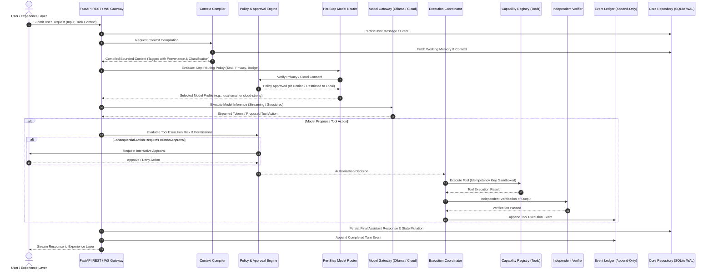

# PICO System Architecture

## 1. System Overview

**PICO** (Personal Intelligence Coordinator & Operator) is a local-first, multi-model personal intelligence architecture engineered to provide persistent memory, verifiable tool execution, private data governance, and deterministic orchestration across local and cloud language models.

PICO rejects the chatbot-wrapper anti-pattern. Instead, it decouples user intent interpretation from model execution, wraps model actions in formal verification contracts, guarantees append-only auditability, and enforces strict data-classification boundaries.

---

## 2. Component Boundaries & Core Subsystems

```
+---------------------------------------------------------------------------------------+
|                                   EXPERIENCE LAYER                                    |
|             (Web UI / CLI / Local IPC - Fast Feedback & Streaming Telemetry)          |
+---------------------------------------------------------------------------------------+
                                           |
                                           v
+---------------------------------------------------------------------------------------+
|                                    PICO CORE                                          |
|                                                                                       |
|  +--------------------+    +--------------------+    +-----------------------------+  |
|  |  Context Compiler  |    | Policy & Approvals |    |    Execution Coordinator    |  |
|  | (Provenance, Tag)  |    | (Risk & Sandboxing)|    |  (DAG, Idempotency, Retries)|  |
|  +--------------------+    +--------------------+    +-----------------------------+  |
|             |                        |                              |                 |
|             +------------------------+------------------------------+                 |
|                                      |                                                |
|                                      v                                                |
|  +---------------------------------------------------------------------------------+  |
|  |                     Model Gateway & Per-Step Router                             |  |
|  |  - Step-by-Step Policy Evaluation (Intent, Reasoning, Cost, Classification)     |  |
|  |  - Profiles: local-small (Qwen 2B), local-mid (Qwen 4B), cloud-strong, embed    |  |
|  |  - Fallback Hierarchy & Cost/Latency Accounting                                |  |
|  +---------------------------------------------------------------------------------+  |
|                                      |                                                |
|                                      v                                                |
|  +--------------------+    +--------------------+    +-----------------------------+  |
|  | Capability Registry|    |Independent Verifier|    |    Observability & Eval     |  |
|  | (Schemas, Tools)   |    | (Invariant Audits) |    |  (Traces, Benchmarks, Evals)|  |
|  +--------------------+    +--------------------+    +-----------------------------+  |
+---------------------------------------------------------------------------------------+
                                           |
                                           v
+---------------------------------------------------------------------------------------+
|                                PERSISTENCE & STATE                                    |
|                                                                                       |
|  +---------------------------------------------------------------------------------+  |
|  |                      Four-Part Memory Service (Unified)                         |  |
|  |  - Working Memory (Ephemeral scratchpad / session context)                      |  |
|  |  - Episodic Memory (Time-indexed past interactions & autobiographical events)   |  |
|  |  - Semantic Memory (Vectorized knowledge graphs, domain facts, concepts)        |  |
|  |  - Procedural Memory (Validated recipes, routines, tool usage playbooks)       |  |
|  +---------------------------------------------------------------------------------+  |
|  +---------------------------------------------------------------------------------+  |
|  |                       Append-Only Event Ledger                                  |  |
|  |  - Immutable event logs, cryptographic provenance, replay & recovery engine     |  |
|  +---------------------------------------------------------------------------------+  |
|  +---------------------------------------------------------------------------------+  |
|  |                       Relational Persistence Layer                              |  |
|  |  - SQLite (WAL mode, Foreign Keys ON) -> Future PostgreSQL repository parity   |  |
|  |  - Conversations, Messages, Projects, Tasks, Audits, Routing Logs             |  |
|  +---------------------------------------------------------------------------------+  |
+---------------------------------------------------------------------------------------+
```

### 2.1 Subsystem Responsibilities

1. **Experience Layer**
   - Renders chat streams, task timelines, approvals, and observability telemetry.
   - Never directly touches models or database tables; communicates exclusively via versioned HTTP/WebSocket APIs.
   - Status: *Phase 1 Slice 1 establishes backend REST API; UI planned for subsequent slices.*

2. **Context Compiler**
   - Synthesizes user requests, relevant memory snippets, active task constraints, and capability descriptors into bounded prompt budgets.
   - Enforces data classification (`PUBLIC`, `INTERNAL`, `SENSITIVE`, `SECRET`).
   - Tags every context segment with source provenance.
   - Status: *Phase 2 Planned.*

3. **Model Gateway & Per-Step Model Router**
   - Evaluates routing rules **per individual execution step**, not merely once per conversation.
   - Routes routine tasks (tagging, intent classification, entity extraction) to `local-small`.
   - Routes complex reasoning and multi-file code synthesis to `cloud-strong` (subject to explicit user consent and privacy policy).
   - Records every routing decision, model fallback, latency, and estimated token cost.
   - Status: *Architecture defined now; adapter interfaces & deterministic router implemented in Phase 1 Slice 2.*

4. **Execution Coordinator**
   - Coordinates complex execution workflows, tool chaining, retries, and job dependency graphs.
   - Enforces strict idempotency keys on every tool execution to prevent duplicate actions.
   - Status: *Phase 2 Planned.*

5. **Capability Registry**
   - Sandboxed registry of available tools with strict JSON schemas.
   - Model outputs are treated as untrusted proposals; parameters are validated against JSON schema definitions before execution.
   - Status: *Phase 2 Planned.*

6. **Policy & Approval Engine**
   - Intercepts all consequential actions (filesystem writes, external network requests, data deletion, shell commands).
   - Issues interactive approval requests to the user when risk thresholds are crossed.
   - Prevents untrusted external content from escalating privileges.
   - Status: *Phase 2 Planned.*

7. **Independent Verifier**
   - Post-execution auditor that evaluates whether tool outputs match expected schemas, invariant conditions, and user constraints.
   - Flags hallucinations or incomplete actions before state is permanently updated.
   - Status: *Phase 3 Planned.*

8. **Four-Part Memory Service**
   - **Working Memory**: In-flight conversational state, active task parameters, and short-term variables.
   - **Episodic Memory**: Narrative history of past conversations, outcomes, and contextual sessions.
   - **Semantic Memory**: Persistent conceptual knowledge, notes, documentation, and user preferences.
   - **Procedural Memory**: Tested patterns, automated routines, tool configurations, and step sequences.
   - Status: *Memory schema and interface defined in Phase 0; service implementation in Phase 2.*

9. **Append-Only Event Ledger**
   - Immutable write-once stream of all system events, state transitions, approvals, tool calls, and model outputs.
   - Enables complete offline replay, debugging, and auditability.
   - Status: *Ledger schema defined in Phase 0; implementation in Phase 2.*

10. **Observability & Evaluation Harness**
    - Tracks per-request latency, token usage, routing accuracy, and model drift.
    - Automated benchmark runner (`tools/bench/`) to clear local models before task delegation.
    - Status: *Test suite established now; benchmark harness in Phase 1 Slice 3.*

11. **Persistence & Background Execution (Phase 1 Slice 1 — Current Focus)**
    - SQLite database with Write-Ahead Logging (`WAL`) mode enabled and strict foreign key constraints.
    - Clean repository/service pattern ensuring zero coupling between business logic and database drivers, ready for seamless PostgreSQL migration.
    - Manages Conversations, Messages, Projects, and Tasks.
    - Status: **ACTIVE IMPLEMENTATION (Phase 1, Slice 1).**

---

## 3. End-to-End Request Data Flow

The following Mermaid diagram traces a user request through the full PICO lifecycle:



---

## 4. Current Slice vs. Future Roadmap

| Subsystem / Feature | Phase 0 (Foundation) | Phase 1 Slice 1 (Current) | Phase 1 Slices 2-4 | Phase 2+ |
|---|---|---|---|---|
| **Architecture & AGENTS.md** | **Implemented** | Active | Maintained | Maintained |
| **Data Model & Schema Spec** | **Implemented** | Active | Extended | Extended |
| **API Contract & Documentation** | **Implemented** | Active | Extended | Extended |
| **Core Entities (Conv, Msg, Proj, Task)** | Spec Complete | **Implemented** | Verified | Extended |
| **SQLite WAL + Foreign Keys** | Spec Complete | **Implemented** | Active | Active |
| **Alembic Migrations** | Spec Complete | **Implemented** | Active | Active |
| **Repository & Service Pattern** | Spec Complete | **Implemented** | Active | Active |
| **Model Gateway Interface** | Spec Complete | Planned | **Implemented** | Active |
| **Streaming Chat & Mock Adapter** | Spec Complete | Planned | **Implemented** | Active |
| **Ollama Adapter (Qwen 2B)** | Spec Complete | Planned | **Implemented** | Active |
| **Configurable Cloud Adapter** | Spec Complete | Planned | **Implemented** | Active |
| **Deterministic Router Skeleton** | Spec Complete | Planned | **Implemented** | Active |
| **Routing Decision Logs Table** | Spec Complete | Planned | **Implemented** | Active |
| **Benchmark Harness (`tools/bench/`)** | Spec Complete | Planned | Planned (Slice 3) | Active |
| **Context Compiler & Memory Service** | Spec Complete | Planned | Planned | Implementing |
| **Capability Registry & Sandboxed Tools** | Spec Complete | Planned | Planned | Implementing |
| **Policy & Approval Engine** | Spec Complete | Planned | Planned | Implementing |
| **Append-Only Event Ledger** | Spec Complete | Planned | Planned | Implementing |
| **Independent Verifier** | Spec Complete | Planned | Planned | Implementing |

---

## 5. Model Gateway Specification (Part D Contract)

### 5.1 Per-Step Model Selection Interface

The gateway does not bind a conversation to a single model. Each reasoning step invokes `resolve_step_route()`:

```python
class StepRoutingRequest(BaseModel):
    task_category: TaskCategory  # e.g., CLASSIFICATION, EXTRACTION, PLANNING, CODING, SUMMARIZATION
    data_classification: DataClassification  # PUBLIC, INTERNAL, SENSITIVE, SECRET
    required_capabilities: list[ModelCapability]  # JSON_SCHEMA, TOOL_CALLS, REASONING
    max_budget_cents: float | None = None
    force_local: bool = False

class StepRoutingDecision(BaseModel):
    profile_id: str  # "local-small", "local-mid", "cloud-strong", "mock"
    provider: str  # "ollama", "cloud_adapter", "mock"
    model_name: str  # "qwen3.5:2b", "claude-3-5-sonnet-20241022", etc.
    decision_reason: str
    cloud_approved: bool
    fallback_profiles: list[str]
```

### 5.2 Deterministic Routing Rules
1. **Secret Data Rule**: Any request containing `SECRET` classified context is strictly pinned to local execution. Cloud routing is prohibited; if local processing is incapable, the task is safely refused with an explanatory notice.
2. **Sensitive Data Rule**: Context classified as `SENSITIVE` remains local unless explicit, interactive user consent is registered.
3. **Task-Specific Routing**:
   - `CLASSIFICATION`, `EXTRACTION`, `SUMMARIZATION`, `TAGGING` -> `local-small` (Ollama Qwen 2B), provided the task has passed the benchmark gate.
   - `PLANNING`, `CODING`, `VERIFICATION` -> `cloud-strong` (or `local-mid` if benchmark cleared and cloud disabled).
4. **Fallback Hierarchy**: If `cloud-strong` fails or is unconfigured, fallback evaluates `local-mid` -> `local-small` only if task complexity permits. PICO never silently substitutes a weak model for a task requiring deep reasoning without notifying the user.
5. **Auditability**: Every decision is persisted to `routing_decisions` table with timestamps, token usage, latency, and estimated cost.
