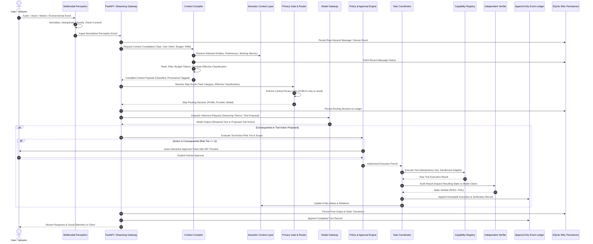

# PICO System Architecture
## Claude Architecture × JARVIS-Class Capabilities × Onix Wingspan 2.0

---

## 1. Executive Summary & Vision

**PICO** (Personal Intelligence Coordinator & Operator) is an original, local-first personal intelligence and execution system. PICO rejects the superficial chatbot-wrapper paradigm. It bridges perception, persistent context, reasoning, deterministic planning, authorized real-world execution, and verifiable auditability.

PICO synthesizes three governing design perspectives:
1. **Claude-Derived Engineering Discipline**: Rigorous separation of concerns, provider-agnostic interfaces, typed context compilation with cryptographic/relational provenance, strict token budgeting, canonical data classification (`PUBLIC`, `INTERNAL`, `SENSITIVE`, `SECRET`), fail-closed security gates, and append-only event ledgering.
2. **Onix Wingspan 2.0 Semantic Context Architecture**: A persistent Semantic Context Layer (Semantic Twin) modeling entities, relationships, workflows, device states, and provenance across personal and engineering domains, allowing coordinated logical workers to act on shared, verified context without hallucinated state.
3. **JARVIS-Class Multimodal Perception & Execution**: First-class multimodal sensory perception (hearing, seeing, movement, environmental telemetry), controlled computer/browser automation, and physical appliance control through Home Assistant, bounded strictly by human-in-the-loop authorization and post-action state verification.

### Core Operating Loop
```
Perceive ──> Understand ──> Retrieve Context ──> Plan ──> Authorize ──> Act ──> Verify ──> Remember
```
- **Read-only queries** conclude cleanly after verification and context update.
- **Consequential or physical actions** must pass through the Policy & Approval Engine, execute through sandboxed adapters with idempotency keys, verify the resulting external state, and append immutable records to the Event Ledger.

---

## 2. Shared Core Architecture & Subsystem Boundaries

PICO maintains two primary operating modes over a unified, shared Core:
- **Personal Assistant**: Long-term conversational continuity, personal memory, reminders, calendar/schedule management, voice interaction, and authorized smart home automation.
- **Engineering Workspace**: Repository comprehension, isolated file and development operations, browser-assisted research, automated testing, diff staging, and git workflow execution.

Both modes share the identical Policy & Approval Engine, Context Compiler, Model Gateway, Memory Services, Task Coordinator, Capability Registry, Independent Verifier, and Event Ledger. Operating in the engineering workspace confers **no privileged bypass** around security, authorization, or audit gates.

```
+-------------------------------------------------------------------------------------------------------------------+
|                                                 EXPERIENCE LAYER                                                  |
|                        Desktop Web UI  |  Voice Push-to-Talk  |  CLI / Local Workspace IPC                        |
+-------------------------------------------------------------------------------------------------------------------+
                                                          |
                                                          v
+-------------------------------------------------------------------------------------------------------------------+
|                                             MULTIMODAL PERCEPTION LAYER                                           |
|       Audio Adapter        |      Vision Adapter       |      Movement Adapter     |    Environmental Sensors     |
|   (Push-to-Talk, STT/TTS)  | (Screenshots, Snapshots)  | (PIR, Frame-Diff, Motion) | (MQTT, ESP32, Home Assistant)|
+-------------------------------------------------------------------------------------------------------------------+
                                                          |
                                             [Normalized Classified Events]
                                                          v
+-------------------------------------------------------------------------------------------------------------------+
|                                                     PICO CORE                                                     |
|                                                                                                                   |
|   +----------------------------+     +-------------------------------+     +----------------------------------+   |
|   |      Context Compiler      |     |   Policy & Approval Engine    |     |      Task Engine Coordinator     |   |
|   |  - Typed Context Items     |     |   - Human-in-the-Loop Tickets |     |   - Stateful Workflow DAGs       |   |
|   |  - Token Budget (4096 ctx) |     |   - Consequential Gatekeeper  |     |   - Checkpoints & Idempotency    |   |
|   |  - Provenance & Ranking    |     |   - Risk Tiers (0, 1, 2, 3)   |     |   - Interruption Recovery        |   |
|   +----------------------------+     +-------------------------------+     +----------------------------------+   |
|                 |                                    |                                       |                    |
|                 v                                    v                                       v                    |
|   +-----------------------------------------------------------------------------------------------------------+   |
|   |                                       Model Gateway & Privacy Router                                      |   |
|   |   - Central Privacy Gate: PUBLIC-only to cloud (requires CLOUD_ENABLED=true); zero private leaks          |   |
|   |   - Profiles: local-small (Qwen 2B), local-mid (Qwen 4B candidate), cloud-strong, embeddings              |   |
|   |   - Deterministic Per-Step Routing: classification severity, task complexity, budget limits               |   |
|   +-----------------------------------------------------------------------------------------------------------+   |
|                 |                                    |                                       |                    |
|                 v                                    v                                       v                    |
|   +----------------------------+     +-------------------------------+     +----------------------------------+   |
|   |    Capability Registry     |     |     Independent Verifier      |     |       Observability & Eval       |   |
|   |  - Strict JSON Schemas     |     |  - Post-Action State Auditor  |     |   - Latency, RAM, VRAM Telemetry |   |
|   |  - Sandboxed Tool Adapters |     |  - Tool Return vs Claim Check |     |   - Golden Eval Suite (50 cases) |   |
|   +----------------------------+     +-------------------------------+     +----------------------------------+   |
+-------------------------------------------------------------------------------------------------------------------+
                                                          |
                                                          v
+-------------------------------------------------------------------------------------------------------------------+
|                                                 PERSISTENCE & STATE                                               |
|                                                                                                                   |
|   +-----------------------------------------------------------------------------------------------------------+   |
|   |                           Semantic Context Layer (Onix Wingspan 2.0 Inspired)                             |   |
|   |   - Entity Graph: Projects, Repos, Files, Devices, Tasks, People, Preferences, Sensor Sources             |   |
|   |   - Grounded Lineage: Relationships backed strictly by verified events or approved sources                |   |
|   +-----------------------------------------------------------------------------------------------------------+   |
|   +-----------------------------------------------------------------------------------------------------------+   |
|   |                                     Four-Part Memory Subsystem                                            |   |
|   |   - Working Memory: Current active task context, conversation state, temporary execution scratchpad       |   |
|   |   - Episodic Memory: Narrative history of interactions, workflow results, time-indexed experiences        |   |
|   |   - Semantic Memory: Approved domain facts, user preferences, entity knowledge (SQLite FTS5 + Vectors)    |   |
|   |   - Procedural Memory: Reusable skills, validated routines, and execution playbooks (Approval Required)   |   |
|   +-----------------------------------------------------------------------------------------------------------+   |
|   +-----------------------------------------------------------------------------------------------------------+   |
|   |                                         Append-Only Event Ledger                                          |   |
|   |   - Write-once immutable audit log: inputs, routing decisions, tool attempts, approvals, state proofs     |   |
|   +-----------------------------------------------------------------------------------------------------------+   |
|   +-----------------------------------------------------------------------------------------------------------+   |
|   |                                  Relational Persistence (SQLite WAL)                                      |   |
|   |   - SQLite 3.12+ (PRAGMA journal_mode=WAL; PRAGMA foreign_keys=ON;), Alembic Migrations, SQLAlchemy 2.0   |   |
|   +-----------------------------------------------------------------------------------------------------------+   |
+-------------------------------------------------------------------------------------------------------------------+
```

---

## 3. End-to-End System Data Flow



---

## 4. Subsystem Specifications

### 4.1 Multimodal Perception Layer (Implemented in Milestone P6)
1. **Audio (Hearing & Speaking)**:
   - Push-to-Talk (PTT) input mode as primary, privacy-preserving interface (`AudioSessionManager`).
   - Provider-neutral STT and TTS adapters (`BaseSpeechToTextAdapter`, `BaseTextToSpeechAdapter`).
   - Honest availability reporting: missing local STT/TTS model runtimes (e.g. whisper/piper) report `state="unavailable"`; no silent cloud fallback. Mock adapters provided for deterministic offline unit testing.
   - Observable capture lifecycle states: `disabled`, `ready`, `capturing`, `processing`, `completed`, `cancelled`, `failed`, `unavailable`.
   - Text chat remains 100% functional when audio subsystem is disabled or unavailable.
   - Wake-word detection deferred until explicit resource and privacy benchmarking passes.
   - Immediate disposal of raw audio PCM; zero raw recordings persisted by default.
2. **Vision (Seeing & Interpreting)**:
   - On-demand visual frame ingestion (`VisionAdapter`) for user uploads, explicit screenshots, or consensual camera snapshots.
   - Mandatory triggering action and consent token (`user_consent=True`); cameras are strictly **OFF by default**.
   - Input bounds: Max 4 MB payload, max 4096×4096 dimensions; pure-Python binary header parsers for PNG, BMP, PPM, and JPEG.
   - Ephemeral processing: Transient pixel buffers released immediately after feature/scene extraction; zero persistent image retention by default.
   - No covert monitoring, continuous background capture, biometric tracking, or facial identification.
3. **Movement & Physical Motion**:
   - Three distinct capability tiers implemented in `MotionAdapter`:
     - **Tier 1 (Motion Detection)**: Bounded binary PIR sensor events. Strictly restricted to motion presence/clearance; refuses to invent unsupported direction or identity.
     - **Tier 2 (Movement Interpretation)**: Deterministic CPU-friendly grayscale frame-differencing between short-lived frames. Computes delta pixel ratio, centroid displacement, direction (`stationary`, `approaching`, `retreating`, `left`, `right`, `up`, `down`), and magnitude (`none`, `subtle`, `moderate`, `significant`).
     - **Tier 3 (Cross-Modal Interpretation)**: `CrossModalCorrelator` correlating related observations (e.g. PIR motion + contact sensor) within a configurable temporal window (default 5.0s), preserving underlying source references, timestamps, and uncertainty.
4. **Environmental & Telemetry Sensors**:
   - Provider-neutral read-only ingestion (`EnvironmentalAdapter`) for MQTT, ESP32, and Home Assistant telemetry: temperature, humidity, ambient lux, contact state, air quality (AQI), battery/power.
   - Bounded schema validation and per-source deduplication cooldowns (suppresses duplicate readings within configurable window).
   - Strict read-only mode: Cannot operate physical switches, locks, alarms, or execute actuator services (physical actuation is strictly reserved for Milestone P7).
5. **Canonical Event Normalization, Persistence & Integration**:
   - Shared Canonical Event Contract (`NormalizedPerceptionEvent`):
     ```python
     class NormalizedPerceptionEvent(BaseModel):
         event_id: str                  # Stable pevt_<uuid>
         correlation_id: str | None
         session_id: str | None
         timestamp: datetime            # UTC timestamp
         modality: Modality             # audio, vision, motion, environmental
         event_type: str
         source_device_id: str
         data_classification: str       # Default INTERNAL; non-PUBLIC never sent to cloud
         confidence: float              # Calibrated 0.0 - 1.0
         raw_payload_scrubbed: bool     # Enforced True
         structured_data: dict[str, Any]
         provenance: str
         retention_policy: RetentionPolicy
         parent_event_id: str | None
     ```
   - Persisted via `PerceptionEventRepository` to dedicated SQLite table `perception_events` (reversible Alembic migration `4e195bc031da`).
   - Context Compiler integration: Formats recent events into `ContextItem` (role: `system`, priority: 45) pruned under budget pressure before mandatory rules (100) or user turns (90).
   - Tool Engine integration: Read-only capabilities (`perception.status`, `perception.get_recent_events`, `perception.validate_sensor_payload`, `perception.analyze_motion`) registered with `RiskTier.READ_ONLY`. Invariant: A perception event never authorizes tool execution on its own.

### 4.2 Semantic Context Layer (Onix Wingspan 2.0 Reference)
- Inspired by Wingspan's Semantic Twin and shared intelligence fabric.
- Models entities: Projects, Repositories, Files, Tasks, Home Devices, Sensors, User Preferences, Decisions, and Workflows.
- Grounded Lineage: Every entity relationship must link to an explicit event in the Event Ledger or a verified source.
- Three Distinct Responsibilities:
  1. **Semantic Context Layer**: Persistent knowledge graph of entities, states, and relationships.
  2. **Context Compiler**: Request-scoped assembler selecting, budgeting, and classifying information for prompt generation.
  3. **Event Ledger**: Immutable append-only audit trail of what was attempted, approved, executed, and verified.

### 4.3 Context Compiler & Four-Part Memory Subsystem
1. **Context Compiler**:
   - Assembles prompt payloads within a documented conservative budget strategy (`conservative-prompt-budget-v1`).
   - Enforces the provider's actual context limit (default 4096 tokens): reserves `completion_reserve` (512 tokens) and `safety_headroom` (256 tokens), capping the prompt budget ceiling to `max_prompt_budget` (3328 tokens) so that prompt + completion + headroom <= 4096.
   - Model-aware tokenizer selection & conservative upper bound: selects chat template and tokenizer matching the target model (`chatml` for Qwen, `openai_chat` for GPT-4). `is_exact_count=False` for all compiled chat requests because complete provider requests include estimated message-framing overhead; when an exact BPE vocabulary is available (e.g. `tiktoken` for GPT-4), text content is exact while `bound_type='exact_content_estimated_framing'`. For Qwen/Ollama, token footprint is conservatively bounded by UTF-8 byte length (`conservative-utf8-byte-bound-v1`) guaranteeing non-underestimation in byte-fallback BPE tokenizers. ChatML template overhead (5 tokens/envelope + 3 tokens generation prompt) is validated against the active model configuration.
   - Mandatory instruction protection: Mandatory system instructions and privacy/safety rules (`is_mandatory=True` or `role='system'`) are allocated first and cannot be pruned for conversational history. If mandatory rules alone exceed the budget, the compiler fails closed with `ValidationError`.
   - Accepts typed `ContextItem` objects carrying explicit source provenance (`msg:`, `proj:`, `task:`, `system:`, `mem:`) and data classifications.
   - Employs deterministic ranking (System Prompt 100 > Current User Message 90 > Active Task/Project Context 80 > Recent Conversation History 50 > Approved Memory 40).
   - Safe boundary truncation: high-priority items exceeding budget are cleanly truncated at word boundaries with explicit truncation notices; historical turns are pruned turn-by-turn.
   - Enforces fail-closed classification: Payload classification equals the highest sensitivity among included items (`SECRET` > `SENSITIVE` > `INTERNAL` > `PUBLIC`); missing/corrupted tags default to `INTERNAL`.
   - Generates inspectable selection logs recording what was included, truncated, or excluded.
2. **Four-Part Memory**:
   - **Working Memory**: In-flight scratchpad, active task parameters, ephemeral conversation turns.
   - **Episodic Memory**: Time-indexed interaction logs, workflow outcomes, and historical lessons.
   - **Semantic Memory**: Verified user preferences, system configuration, domain facts (SQLite FTS5 keyword indexing initially, vector embeddings added only when justified).
   - **Procedural Memory**: Reusable skills, verified tool sequences, and automated playbooks (requires explicit user approval before activation).

### 4.4 Model Gateway & Privacy Gate
1. **Central Privacy Gate**:
   - **PUBLIC-only Cloud Rule**: Only context payloads whose effective classification is strictly `PUBLIC` may be routed to external cloud models, and only when `CLOUD_ENABLED=true`.
   - **Hard Local Pin**: Any payload containing `INTERNAL`, `SENSITIVE`, `SECRET`, missing, or unknown classifications is strictly pinned to local execution or fails closed.
   - **Zero Secret Leakage**: API keys, bearer tokens, and credentials live exclusively in server-side environment variables and are scrubbed from all prompt assembly, logs, and client responses.
   - **Defense in Depth**: Verification checks exist at the Router, API endpoint, and inside the Cloud Provider adapter itself.
2. **Model Profiles**:
   - `local-small`: Default Ollama model (`qwen3.5:2b`), context window 4096 tokens, `think=False` by default for fast, bounded routine tasks.
   - `local-mid`: Candidate Ollama model (`qwen3.5:4b`), enabled only after benchmark validation on host hardware.
   - `cloud-strong`: Configurable cloud model (OpenAI, Anthropic, Gemini) for deep reasoning on purely `PUBLIC` data.
   - `mock`: Deterministic offline test provider for CI and zero-dependency unit tests.

### 4.5 Tool Execution & Verification Engine (Implemented in Milestone P5)
1. **Explicit Capability Registry**:
   - Capabilities must be registered explicitly in trusted server-side code (`pico.capabilities.registry.registry`). Dynamic execution of arbitrary code, shell commands, or unvetted scripts is strictly prohibited.
   - Declarative metadata per capability: `capability_id`, `version`, `name`, `description`, `risk_tier` (`READ_ONLY`, `LOW`, `MEDIUM`, `HIGH`, `CONSEQUENTIAL`), `required_permission`, `required_classification`, `timeout_seconds`, `max_output_bytes`, `idempotent`, `consequential`.
   - Initial safe capabilities: `core.calculator` (bounded AST arithmetic), `core.validate_json` (syntax & key validator), `db.read_project` / `db.read_task` (read-only SQLite repository access), `system.diagnostics` (deterministic health and connection check), and test capabilities.
2. **Task Execution State Machine**:
   - Documented lifecycle transitions: `queued -> running -> verifying -> succeeded`, with error/recovery states: `awaiting_approval`, `failed`, `cancelled`, `timed_out`, `verification_failed`, `retry_scheduled`.
   - Database transactions for all state transitions, surviving engine disposal and system crashes.
   - Crash Recovery: Startup hook (`ToolExecutionEngine.recover_interrupted_executions()`) scans for executions left in `running` or `verifying` states across application restart and marks them as `failed` with explicit crash recovery notes.
3. **Idempotency, Deadlines & Cooperative Cancellation**:
   - Unique `idempotency_key` enforcement at submission time; duplicate submissions return existing execution records without re-execution.
   - Strict deadline tracking with configurable `timeout_seconds` enforced via `asyncio.wait_for`.
   - Cooperative cancellation supported for `queued` and `awaiting_approval` tickets.
4. **Independent Deterministic Verification**:
   - Independent verification stage executed after capability handler completion.
   - Verifies returned payload against output schema, verifies mathematical or state consistency independently, and validates execution evidence.
   - Verifier failure marks execution as `verification_failed` — an execution is never marked successful merely because its handler did not throw an exception.
5. **Trusted Authorization & Human Approval**:
   - Consequential capabilities strictly require human approval bound to an immutable SHA-256 `input_digest`.
   - Tampered input parameters invalidate existing approval tickets.
   - Approval identity is verified against server-side trusted identities (`settings.TRUSTED_APPROVER_IDENTITIES`) and token (`X-Pico-Approval-Token`). Model-generated strings or untrusted callers cannot authorize actions.
6. **Append-Only Event Ledger**:
   - Write-once audit log (`event_ledger`) tracking all lifecycle events (`task_submitted`, `execution_started`, `verification_passed`, etc.).
   - Automatic recursive credential and secret scrubbing (`api_key`, `token`, `secret`, `password`, `authorization`).
7. **Procedural Memory Integration**:
   - Procedure validation (`/api/tools/procedures/{id}/validate`) checks each procedure step against the Capability Registry, verifying capability availability and flagging required approval tickets without allowing procedures to self-activate.


### 4.6 Computer Control & Engineering Workspace
1. **OS & Desktop Application Automation (Verified in Milestone P8.1)**:
   - **Provider-Neutral OS Adapter Boundary (`pico.os_automation`)**:
     - `BaseOSAutomationAdapter`: Abstract interface defining `inspect_windows()` and `launch_application()`.
     - `WindowsAutomationAdapter`: Windows 11 implementation utilizing standard-library `ctypes` (`user32.EnumWindows`, `GetWindowTextW`, `GetWindowThreadProcessId`) for read-only window enumeration and `subprocess.Popen` with `shell=False` for process creation.
     - `FakeOSAutomationAdapter`: Synthetic, deterministic adapter for CI and automated testing ensuring zero real desktop side effects during testing.
     - Unsupported platforms (non-Windows) are reported honestly with status `unsupported` rather than simulating success.
   - **Read-Only Window Inspection (`os.inspect_windows`)**:
     - Dedicated read permission: `os:inspect`, risk tier `RiskTier.READ_ONLY`, non-consequential, idempotent.
     - Conservative data classification: `INTERNAL` (never automatically routed to cloud models).
     - Strict bounding: clamps returned window count (`max_windows`, default 50, ceiling 100) and title length (`max_title_length`, default 256, ceiling 512).
     - Strictly read-only: inspects window metadata (handle, title, process ID, visibility, minimized/iconic, foreground focus); zero window content reading, keystroke/mouse injection, screenshot capture, or desktop mutation.
   - **Explicit Application Allowlist & Launch Boundary (`os.launch_application`)**:
     - Dedicated permission: `os:launch`, risk tier `RiskTier.HIGH`, `consequential=True`, `idempotent=False`, strictly zero automatic retries (`max_retries=0`).
     - Server-side trusted configuration: Application allowlist is configured via server configuration (`OS_APPLICATION_ALLOWLIST`) and is **strictly empty by default**.
     - Fixed Launch Profiles (`LaunchProfile`): Maps validated alias (`^[a-zA-Z0-9_\-]+$`) to approved executable path, static argument list, and optional working directory.
     - Strict Security Invariants:
       - Fails closed on unknown aliases, directory traversal (`..`), relative paths, and environment variable expansion (`%`, `$`).
       - Interpreters, shells, and script runners (`cmd.exe`, `powershell.exe`, `pwsh.exe`, `bash.exe`, `sh.exe`, `python.exe`, `wscript.exe`, `cscript.exe`) are strictly prohibited from the allowlist.
       - Disallowed script extensions (`.bat`, `.cmd`, `.ps1`, `.vbs`, `.js`, `.py`, `.sh`) are rejected; only direct binary executables (`.exe`) are permitted.
       - Model/caller input is schema-restricted via `extra="forbid"` to only `alias`; callers cannot supply or override paths, arguments, environment, or working directory.
       - Direct process creation with `shell=False`. Constructing shell command strings is strictly prohibited.
       - Environment Sanitization: Child processes run in a minimal, controlled environment excluding PICO secrets, approval tokens, Home Assistant tokens, database credentials, and cloud API keys (`build_sanitized_environment()`).
        - **Launch Profile Fingerprint Binding (P8.1 Hardening)**:
          - Trusted Canonical Fingerprint: `compute_launch_profile_fingerprint()` computes a deterministic SHA-256 hash over canonical JSON encoding `alias`, normalized `executable_path`, ordered `args`, and normalized `working_dir`.
          - Server-Side Submission Binding: `prepare_input` hook calculates and injects `launch_fingerprint` into execution input prior to validation and `input_digest` calculation, cryptographically binding the profile into the single-use human approval ticket. Caller-supplied, missing, or mismatched fingerprints fail closed.
          - Execution Boundary Re-Verification: At actual dispatch, `ToolExecutionEngine.execute` and `LaunchApplicationCapability.execute` re-resolve the current allowlist profile, recompute its fingerprint, and assert exact match with the approval-bound fingerprint. Any post-approval mutation to executable path, arguments, working directory, or allowlist configuration fails closed with zero process creations.
   - **Launch Verification & State Machine**:
     - Consequential approval requirement: Single-use human operator approval ticket bound to SHA-256 input digest (`APPROVAL_SECRET_TOKEN` validation).
     - Atomic claim (`claim_execution` compare-and-set) prevents duplicate or concurrent dispatches.
     - Honest Verification Statuses: Distinct states for `request_rejected`, `awaiting_approval`, `launch_dispatched`, `process_creation_confirmed`, `launch_uncertain`, `launch_failed`, and `independent_window_observation_confirmed`. Process creation is never equated with proof of application usability.
2. **Staged Filesystem Diffs (Verified in Milestone P8.2)**:
   - **Restricted Filesystem Access Boundary & Server Root Allowlist**:
     - Provider-neutral filesystem boundary (`pico.filesystem`): `BaseFilesystemAdapter`, `WindowsFilesystemAdapter`, and `FakeFilesystemAdapter`.
     - Server-side root allowlist (`PICO_FILESYSTEM_ALLOWED_ROOTS`): Maps root identifiers to canonical absolute directory paths. **Strictly empty by default**.
     - Absolute containment validation: All target paths must remain strictly within an authorized canonical root.
     - Hard path rejection: Traversal (`..`), alternate separators (`/` on Windows / raw mixing), Windows device paths (`CON`, `PRN`, `AUX`, `NUL`, `COM1-9`, `LPT1-9`), UNC/device namespaces (`\\.\`, `\\?\`), and environment variables (`%`, `$`) are rejected fail-closed.
     - Reparse Point & Symlink Defense: Target files and all parent directories in ancestry are checked against symlinks and Windows reparse points (`FILE_ATTRIBUTE_REPARSE_POINT`). Any link or junction escaping the root fails closed.
   - **Bounded Text-Only Contract**:
     - Strict UTF-8 text only; rejects binary payloads, NUL bytes (`\x00`), and unsupported encodings.
     - Strict size limits: `max_file_bytes` (default 256 KB), `max_line_length` (default 4096 chars), `max_diff_bytes` (default 256 KB).
     - Newline policy: Normalizes all line endings canonically to `\n` (LF) for deterministic diffing and hashing.
     - Allowed operations limited strictly to `create` (new file, parent exists, target absent) and `replace` (full text replacement of existing file). Deletion, move, permissions, directory creation, and binary editing are prohibited in P8.2.
   - **Staged Proposal Model & Unified Diff Review**:
     - Structured `StagedDiff` entity recording proposal ID, root ID, relative path, operation, original SHA-256 (`ABSENT` or content hash), proposed SHA-256, unified diff text, and diff SHA-256.
     - Original content snapshot retained in secure local SQLite storage for deterministic rollback.
     - Human operator reviews the exact byte-for-byte diff before approval.
   - **Cryptographic Approval Binding & Consequential Execution**:
     - Dedicated permission `filesystem:write`, `RiskTier.HIGH`, `consequential=True`, `idempotent=False`, zero automatic retries (`max_retries=0`).
     - Server-side `prepare_input` hook calculates and injects trusted `original_content_digest`, `proposed_content_digest`, and `diff_digest` before `input_digest` computation. Callers cannot forge digests or paths.
     - Pre-dispatch gate in `ToolExecutionEngine`: Immediately before dispatch, re-verifies root allowlist membership, checks target file on disk against `expected_original_digest`, and verifies proposed content and diff against stored proposal. Any post-approval change to disk, proposal, or allowlist fails closed with zero writes.
     - Atomic write: Safe temporary file created in the target directory (`.pico_tmp_*`), flushed and synced to disk (`os.fsync`), then atomically moved into place (`os.replace`).
   - **Independent Verification & Guarded Conflict-Safe Rollback**:
     - Independent read-back: Re-opens destination file through canonical boundary, reads contents, and verifies SHA-256 hash matches the approved proposed digest.
     - Guarded rollback (`filesystem.rollback_staged_diff`): Requires dedicated authorization, verifies file currently on disk still matches post-apply hash (fails closed if external edits occurred), restores original content atomically, and independently verifies restored state.
3. **Sandboxed Browser Automation (Verified in Milestone P8.3)**:
   - **Provider-Neutral Browser Adapter Boundary (`pico.browser`)**:
     - `BaseBrowserAdapter`: Abstract interface defining `open_page(url, timeout_seconds, max_bytes, max_links)`.
     - `PlaywrightBrowserAdapter`: Production implementation utilizing Playwright with ephemeral browser contexts, route interception for subresource/origin enforcement, popup/download blocking, and Chromium sandbox enabled. Playwright is an optional runtime dependency loaded lazily, truthfully returning `unavailable` status if the library or browser binaries are not installed, without uncontrolled background downloads.
     - `FakeBrowserAdapter`: Deterministic fake browser adapter for offline unit tests and CI, enforcing identical security, origin allowlist, and SSRF gates against registered test fixtures with zero network dependencies.
   - **Fail-Closed Security Configuration**:
     - Browser automation is disabled by default (`BROWSER_AUTOMATION_ENABLED=False`).
     - Server-side origin allowlist (`BROWSER_ALLOWED_ORIGINS=[]`) is strictly empty by default with zero wildcard allowlisting.
     - Destination validation rejects unsupported schemes (only `http` and `https`), embedded credentials, malformed URLs, and unapproved origins.
     - Comprehensive SSRF mitigation validates IP literals and resolved hostnames against loopback (`127.0.0.0/8`, `::1`), private (`10.0.0.0/8`, `172.16.0.0/12`, `192.168.0.0/16`), link-local (`169.254.0.0/16`), and cloud metadata (`169.254.169.254`, `metadata.google.internal`) addresses before navigation and on every redirect or subresource request.
   - **Ephemeral Contexts & Untrusted Content Isolation**:
     - Fresh, non-persistent browser context per request with zero persistence or leakage of cookies, credentials, session tokens, or local storage.
     - Non-essential capabilities disabled: downloads, service workers, browser permissions, file uploads, and arbitrary JavaScript execution are blocked.
     - Chromium security sandbox remains enabled (strictly never `--no-sandbox`).
   - **Bounded Observations & Privacy Pinned Data**:
     - Page observations return bounded structures with explicit length truncation indicators (`max_bytes=65536`, `max_links=50`).
     - Query strings, authentication tokens, and fragments are stripped from logged and persisted URLs (`sanitize_url`).
     - External web content is strictly classified as untrusted `INTERNAL` data and pinned to local execution via `RULE_PRIVATE_LOCAL_PIN` (zero cloud transmission).
     - Adversarial web text cannot elevate caller permissions, alter tool schemas, or bypass the Policy & Approval Engine.
   - **Capability Registration & Verification**:
     - Registered capability `browser.open_page` (`RiskTier.READ_ONLY`, `browser:open` permission, `INTERNAL` classification, idempotent, zero retries).
     - Independent post-execution verifier validates output structure and schema conformance.

### 4.7 Home Automation & Physical Actuation (Home Assistant)
- Home Assistant REST/WebSocket API as the sole integration hub.
- Phased Progression:
  - **Stage A (Read-Only Awareness — Verified in Milestone P7.1 & P7.2)**:
    - **Hub Connector (`HomeAssistantClient`)**: Authenticated REST transport (`GET /api/`, `GET /api/states`, `GET /api/states/{id}`) and pure-Python asyncio WebSocket transport (`ws://host:port/api/websocket`).
    - **Protocol Invariants**: Strict read-only command allowlist (`get_states`, `get_config`, `ping`, controlled `subscribe_events`). Rejects any mutation or generic execution command.
    - **Safe Configuration**: Disabled by default (`HOME_ASSISTANT_ENABLED=false`). Dedicated token configuration. Base URL validation prevents SSRF or arbitrary URL fetching. Zero token leakage across redirects, logs, or error envelopes.
    - **Trusted Classification**: Household observations are strictly classified as at least `INTERNAL`. Sensitive domains (`lock`, `alarm_control_panel`, `camera`, `person`, `device_tracker`, and entry-point `binary_sensor`) are classified as `SENSITIVE`. Caller has zero authority to downgrade home state to `PUBLIC`. Strictly pinned to local execution under PICO's privacy gate.
    - **Bounded State Reads**: Transient in-memory state reads; GPS coordinates, tokens, and personal identifiers are scrubbed. No permanent tracking database in Stage A.
    - **Read-Only Capabilities**: Registered in `CapabilityRegistry` under `RiskTier.READ_ONLY` (`homeassistant.status`, `homeassistant.list_entities`, `homeassistant.get_entity_state`, `homeassistant.overview`). Verifier rejects any false claim of physical device connectivity.
    - **Absolute Read-Only Boundary**: Zero actuation, service calls (`call_service`), or state mutation paths exist.
  - **Stage B (First End-to-End Control — Verified in Milestone P7.3)**: Harmless single light toggle through the complete loop (Intent -> Context -> Plan -> Approval -> Act -> State Verification -> Event Ledger).
  - **Stage C (Allowlisted Switches & Plugs — Verified in Milestones P7.4.1 & P7.4.1.2)**:
    - Dedicated capability: `homeassistant.allowlisted_switch_actuate`.
    - Triple enablement required (`HOME_ASSISTANT_ENABLED=true`, `HOME_ASSISTANT_ACTUATION_ENABLED=true`, `HOME_ASSISTANT_SWITCH_ACTUATION_ENABLED=true`).
    - Explicit server configuration allowlist (`HOME_ASSISTANT_SWITCH_ALLOWLIST`): exact JSON list of `switch.*` entities only.
    - Consequential risk tier (`RiskTier.HIGH`), `homeassistant:actuate` permission, `INTERNAL` data classification, zero retries (`max_retries=0`).
    - Exact operations: `switch.turn_on` and `switch.turn_off`. `toggle` and generic service calls (`call_service`) are prohibited.
    - Truthful state preflight & 4-way classification: `SwitchActuationPlan` and `SwitchActuationReadinessReport` explicitly categorize state readiness into `ready` (`is_mutation_needed=True`), `already_satisfied` (`is_mutation_needed=False`), `state_unavailable` (`is_mutation_needed=False`), and `state_unknown` (`is_mutation_needed=False`). Unknown or unavailable states are never presented as proofs of satisfaction.
    - Fail-closed pre-dispatch policy: Authoritative pre-dispatch state read verifies that the switch is in the known opposite valid state before issuing mutation requests. Missing entities (404), network errors, timeouts, or invalid/empty/`unknown`/`unavailable` states fail closed with `dispatch_status='blocked_precondition'`, resulting in zero physical mutation requests.
    - Redundant dispatch avoidance: skips mutation if authoritative read confirms current state already matches target state (`dispatch_status='already_satisfied'`).
    - Independent verification: post-dispatch verification via read-only state inspection (`GET /api/states/{id}`). Never claims physical device connectivity.
    - Read-only preflight readiness inspection via CLI, REST API (`/api/homeassistant/switch/readiness`), and capability (`homeassistant.switch_readiness`). Non-on/off live states fail commissioning with `STATE_UNAVAILABLE` or `STATE_UNKNOWN`.
  - **Stage D (Climate & Environmental Controls — P7.4.2.2, P7.4.2.3, & P7.4.2.4 Verified)**:
    - **P7.4.2.1 / P7.4.2.1.1 / P7.4.2.1.2 / P7.4.2.1.3 (Read-Only Climate Feasibility & Trusted Grid-Origins)**: Strictly read-only feasibility planning with decimal-safe step-grid alignment against server-configured `HOME_ASSISTANT_CLIMATE_GRID_ORIGINS`.
    - **P7.4.2.2 (Allowlisted Single-Setpoint Climate Actuation)**: First physical climate actuation slice. Narrowly registered capability `homeassistant.allowlisted_climate_setpoint_actuate` (`RiskTier.HIGH`, `homeassistant:actuate` permission, `INTERNAL` classification, `consequential=True`, `idempotent=False`, `max_retries=0`).
    - **P7.4.2.3 (Read-Only Dual-Setpoint Feasibility Planning)**: Read-only feasibility planning for dual-target temperature ranges (`target_temp_low` and `target_temp_high`) via `POST /api/homeassistant/climate/dual-setpoint/plan`. Strictly zero physical mutations (`is_mutation_performed: false`). Enforces explicit dual-setpoint capability (bit 1 of `supported_features`), active `heat_cool` operating mode (no automatic mode changes), strict range ordering (`low < high`), authoritative bounds, and decimal-safe grid-origin alignment.
    - **P7.4.2.4 (Allowlisted Dual-Setpoint Climate Actuation)**: Scoped physical dual-setpoint actuation slice. Narrowly registered capability `homeassistant.allowlisted_climate_dual_setpoint_actuate` (`RiskTier.HIGH`, `homeassistant:actuate`, zero retries). Dedicated enablement gate `HOME_ASSISTANT_CLIMATE_DUAL_SETPOINT_ACTUATION_ENABLED=true` (disabled by default). Authoritative pre-dispatch verification, single dispatch `climate.set_temperature` with `target_temp_low` and `target_temp_high` (0 retries), independent read-after-write verification, and skip on already-satisfied setpoints. Rejects mode switches, fan/preset changes, single-setpoint `temperature`, non-finites, and generic services.
    - Dedicated enablement: Requires all independent gates: `HOME_ASSISTANT_ENABLED=true`, `HOME_ASSISTANT_ACTUATION_ENABLED=true`, `HOME_ASSISTANT_CLIMATE_AWARENESS_ENABLED=true`, `HOME_ASSISTANT_CLIMATE_ACTUATION_ENABLED=true`, `HOME_ASSISTANT_CLIMATE_DUAL_SETPOINT_ACTUATION_ENABLED=true` (for dual-setpoint, disabled by default), validated server-side `HOME_ASSISTANT_CLIMATE_ALLOWLIST`, server-configured `HOME_ASSISTANT_CLIMATE_GRID_ORIGINS`, and `APPROVAL_SECRET_TOKEN`.
    - Strict boundary: Operating mode changes, fan mode changes, preset activation, and generic service calls (`call_service`) remain strictly prohibited.
    - Pre-dispatch gate: Authoritative fresh state read immediately prior to dispatch re-validating all safety preconditions. If the reported target setpoint(s) already equal the requested setpoint(s), mutation is skipped (`dispatch_status='already_satisfied'`).
    - Single dispatch & zero retries: Exactly one physical call to `POST /api/services/climate/set_temperature`. Zero automatic retries on timeouts or failures.
    - Independent verification: Read-after-write state polling via read-only state endpoint (`GET /api/states/{id}`). Never claims physical device connectivity (`physical_device_connectivity_claimed=False`).
    - Advanced climate controls (HVAC mode switching, fan/preset control) remain planned under future Stage D milestones.
- Security-sensitive actuators (door locks, security systems) remain **NOTIFY-ONLY** / blocked under current policy.

### 4.8 Independent Verifier & Event Ledger
- Independent Verifier audits post-action state directly from external systems (e.g. filesystem check, API return, Home Assistant entity state) rather than trusting model narration.
- Append-Only Event Ledger persists immutable audit events with timestamps, correlation IDs, input parameters, approval tickets, and verification proofs.

---

## 5. Host Hardware & Resource Constraints

Target Environment:
- **CPU**: Intel Core i5-13420H (8 cores / 12 threads)
- **RAM**: 16 GB DDR5 System RAM
- **GPU**: NVIDIA GeForce RTX 3050 Laptop GPU (4 GB dedicated VRAM)
- **Disk**: ~60 GB available storage
- **Host OS**: Windows 11 with PowerShell

### Non-Negotiable Resource Invariants
1. **Single Model Residency**: At most one inference model resident in GPU VRAM/RAM at any time. Simultaneous chat and embedding model residency is prohibited until formal benchmark headroom is proven.
2. **No Oversized Models**: 70B+ or 125B+ models are strictly out of scope for the local host hardware.
3. **Context Limit**: Active local model context window is strictly bounded to 4096 tokens (8192 tested only under measured telemetry).
4. **Graceful Degradation**: Core persistence, local task management, and deterministic workflows remain 100% operational when Ollama or internet connectivity is unavailable.

---

## 6. Comprehensive Capability Matrix / Inventory

| Capability ID | Capability Name | Purpose | Subsystem / Layer | Dependencies | Risk Tier | Data Classification | Required Hardware / Integration | Current Evidence | Implementation Status | Acceptance Criteria |
|---|---|---|---|---|---|---|---|---|---|---|
| **CAP-CORE-01** | Core Persistence Engine | Relational storage for conversations, messages, projects, tasks | Persistence | SQLite WAL, SQLAlchemy 2.0 | Tier 0 (Read/Internal) | `INTERNAL` | Host Filesystem | `tests/test_conversations.py`, `tests/test_messages.py`, `tests/test_persistence_reopen.py` | **VERIFIED** | Clean schema migrations, foreign keys enabled, WAL mode active, zero data corruption on restart. |
| **CAP-MOD-01** | Provider-Agnostic Gateway | Abstract interface for local & cloud LLMs | Model Gateway | `pico.providers.base` | Tier 0 (Read) | `PUBLIC` to `SECRET` | Python runtime | `tests/test_mock_provider.py` | **VERIFIED** | Supports streaming, cancellation, metadata, typed error hierarchies. |
| **CAP-MOD-02** | Local Ollama Provider | Fast local private inference (`qwen3.5:2b`) | Model Gateway | Ollama daemon | Tier 0 (Compute) | `PUBLIC` to `SECRET` | Host CPU / RTX 3050 | `tests/test_ollama_provider.py` | **VERIFIED** | Async NDJSON streaming, 4096 context window, explicit `think` precedence contract. |
| **CAP-MOD-03** | Configurable Cloud Provider | Strong reasoning for eligible public tasks | Model Gateway | OpenAI-compatible endpoint | Tier 1 (External egress) | `PUBLIC` strictly | Internet connectivity | `tests/test_cloud_provider.py` | **VERIFIED** | Opt-in via `CLOUD_ENABLED=true`, zero canary secret leakage, defense-in-depth non-PUBLIC rejection. |
| **CAP-SEC-01** | Central Privacy Gate | Deterministic enforcement of data routing policy | Security / Router | `pico.services.routing_service` | Tier 0 (Gatekeeper) | All | None | `tests/test_routing_service.py`, `tests/test_chat_stream_api.py` | **VERIFIED** | Only PUBLIC context reaches cloud; effective context sensitivity computation; hard local pin for private data. |
| **CAP-TEL-01** | Hardware Benchmark Runner | Telemetry harness for TTFT, tok/s, RAM, VRAM | Observability | `tools/bench/` | Tier 0 (Diagnostics) | `INTERNAL` | Windows kernel32, nvidia-smi | `tests/test_bench_runner.py`, `tests/test_automation_scripts.py` | **VERIFIED** | Preflight checks, zero automatic model downloads, synthetic benchmark prompts, JSON/MD reporting. |
| **CAP-CTX-01** | Context Compiler v0 | Typed context assembly, token budgeting & provenance | Context / Memory | `pico.services.context_compiler` | Tier 0 (Compute) | All | None | `pico/services/context_compiler.py`, `tests/test_context_compiler.py` | **VERIFIED (P2)** | 4096-token budget enforced via conservative budget strategy (3328 prompt ceiling, 512 completion reserve, 256 headroom), conservative BPE upper-bound, fail-closed classification, provenance tags, inspectable decisions. |
| **CAP-MEM-01** | Four-Part Memory Service | Working, episodic, semantic, and procedural knowledge | Memory | SQLite FTS5, Context Compiler | Tier 0 (Storage) | `INTERNAL` / `SENSITIVE` | SQLite | Documented spec in `docs/architecture.md` | **PLANNED (P4)** | Memory items carry provenance and approval status; proposed vs approved facts separated; FTS5 search. |
| **CAP-TSK-01** | Stateful Task Engine | Persistent multi-step execution coordinator | Task Engine | SQLite, Context Compiler | Tier 1 (Execution) | `INTERNAL` | SQLite | Documented spec in `docs/architecture.md` | **PLANNED (P5)** | Persistent DAG states, idempotency keys, interrupt recovery, bounded retries. |
| **CAP-TOOL-01**| Capability Registry | Sandboxed tool allowlist with strict JSON schemas | Tools / Execution | Pydantic v2, Task Engine | Tier 1 (Execution) | Scoped | Host OS | Documented spec in `docs/architecture.md` | **PLANNED (P5)** | Schema validation on all proposals, least-privilege scoping, clear error envelopes. |
| **CAP-POL-01** | Policy & Approval Engine | Human-in-the-loop gatekeeper for consequential actions | Security | Capability Registry | Tier 0 (Gatekeeper) | All | Experience Layer | Documented spec in `docs/security-and-risk-register.md` | **PLANNED (P5)** | Interactive approval ticket with diff display for consequential writes/deletions/transfers. |
| **CAP-AUD-01** | Append-Only Event Ledger | Immutable audit trail for all inputs, actions, proofs | Auditability | SQLite, Task Engine | Tier 0 (Audit) | All | SQLite | Documented spec in `docs/data-model.md` | **PLANNED (P5)** | Write-once append-only log, cryptographic hash chains, deterministic replay for debugging. |
| **CAP-PER-01** | Push-to-Talk Voice Interface | Local voice input and transcription | Perception | Local STT, Audio capture | Tier 1 (Sensor) | `SENSITIVE` | Host Microphone | Documented spec in `docs/architecture.md` | **PLANNED (P6)** | Explicit PTT activation, visible mic active indicator, local-only transcription, instant cancel. |
| **CAP-PER-02** | Visual Inspection Adapter | User-requested screenshots & camera snapshots | Perception | Screen capture, OpenCV/Camera | Tier 1 (Sensor) | `SENSITIVE` | Host Display, Webcam | Documented spec in `docs/architecture.md` | **PLANNED (P6)** | Cameras off by default, temporary frames discarded post-inference, explicit capture trigger. |
| **CAP-PER-03** | Movement & Motion Sensor | Motion event ingestion and change detection | Perception | Camera diffing, PIR sensor | Tier 1 (Sensor) | `INTERNAL` | Host Camera / PIR Hub | Documented spec in `docs/architecture.md` | **PLANNED (P6)** | Confidence-rated motion events, event normalization, cooldown deduplication, zero covert tracking. |
| **CAP-PER-04** | Environmental Telemetry | Sensor ingestion for temperature, light, presence | Perception | MQTT / Home Assistant API | Tier 0 (Ingest) | `INTERNAL` | Sensor network / Hub | Documented spec in `docs/architecture.md` | **PLANNED (P6)** | Normalized sensor contracts, offline test doubles, rate limiting. |
| **CAP-HA-01**  | Home Assistant Appliance Control | Physical smart home awareness and actuation | Physical World | Home Assistant API | Tier 2 (Actuation) | `INTERNAL` | Home Assistant Hub | `tests/test_homeassistant_actuation.py`, `tests/test_homeassistant_switch_actuation.py`, `tests/test_homeassistant_climate_actuation.py` | **VERIFIED (Stage A, B, C, D Single- & Dual-Setpoint)** | Stage A (read-only), Stage B (verified light toggle), Stage C (allowlisted switches/plugs), Stage D (allowlisted single- and dual-setpoint climate) verified. Mode, fan, and preset switching remain planned. High-impact security controls remain blocked. |
| **CAP-PC-01**  | Computer & Workspace Control | Sandboxed application, window, and file automation | Workspace | OS accessibility, Playwright | Tier 2 (Automation) | `INTERNAL` / `SENSITIVE` | Host OS | Documented spec in `docs/architecture.md` | **PLANNED (P8)** | Reversible staged diffs, isolated browser profile, untrusted web content isolation, verification before success claims. |
| **CAP-AGT-01** | Multi-Agent Coordination | Subtask delegation over Task Engine | Coordination | Task Engine, Single Model | Tier 1 (Orchestration)| All | Host CPU / GPU | Documented spec in `docs/architecture.md` | **PLANNED (P9)** | Logical workers scheduled over single resident model, independent verification of worker outputs. |
| **CAP-EXP-01** | Unified PICO Experience | Real-time web UI, streaming chat, approval cards | Experience Layer | FastAPI, SSE, Web frontend | Tier 0 (Presentation) | All | Modern Browser | Documented spec in `docs/api-contract.md` | **PLANNED (P10)**| Streaming chat, voice toggle, sensor indicators, memory inspection, approval interaction, offline resilience. |

---

## 7. Canonical Implementation Roadmap (P0–P10)

### Milestone P0: Architecture & Repository Baseline
- Inventory codebase, schemas, tests, and documentation.
- Establish canonical architecture record, data model contracts, and capability inventory.
- *Status*: **VERIFIED & MAINTAINED**.

### Milestone B1: Think-Behavior Reliability
- Implement and verify Ollama `think` parameter precedence: `GenerationOptions.think` -> Provider default (`think=False`) -> Omitted.
- Test actual outbound provider payload serialization across all boolean and omitted combinations.
- *Status*: **VERIFIED** (`tests/test_ollama_provider.py`).

### Milestone P1: Central Privacy Gate & Context Sensitivity
- Enforce strict PUBLIC-only cloud inference rule (`CLOUD_ENABLED=true` required).
- Compute effective classification across all assembled context items (`SECRET` > `SENSITIVE` > `INTERNAL` > `PUBLIC`).
- Hard local pin for non-PUBLIC context (`RULE_PRIVATE_LOCAL_PIN`).
- Defense-in-depth security verification in Cloud provider adapter and chat streaming endpoints.
- *Status*: **VERIFIED** (`tests/test_routing_service.py`, `tests/test_chat_stream_api.py`, `tests/test_cloud_provider.py`).

### Milestone P2: Context Compiler v0
- Accept typed `ContextItem` inputs with explicit source provenance and data classifications.
- Enforce documented 4096-token budget using calibrated `heuristic-char-word-v1` counter.
- Deterministic ranking: System Prompt > Current User Turn > Active Task Context > Recent History > Memory.
- Fail-closed sensitivity computation: Payload sensitivity equals highest severity item; invalid classifications default to `INTERNAL`.
- Full inspectable selection logs (included, truncated, excluded decisions with reasons).
- Integrated into `POST /api/chat/stream` pipeline.
- *Status*: **ACTIVE / IMPLEMENTATION TARGET**.

### Milestone P3: Hardware Benchmarks & Quality Gates
- Execute multi-repetition benchmark suite measuring TTFT, tokens/sec, RAM, and VRAM.
- Measure available `qwen3.5:2b` baseline and evaluate proposed `qwen3.5:4b` under single-model residency.
- Preflight availability gate preventing unreviewed model downloads.
- Machine-readable benchmark reports in `bench_reports/`.
- *Status*: **FOUNDATION BUILT (`tools/bench/`), PENDING P2 COMPLETION**.

### Milestone P4: Memory v1 (Four-Part Subsystem)
- Implement Working, Episodic, Semantic, and Procedural memory stores.
- SQLite FTS5 search and retrieval for semantic memory.
- Provenance tags and distinction between proposed facts and human-approved knowledge.
- *Status*: **PLANNED**.

### Milestone P5: Task Engine, Capability Registry & Event Ledger
- Persistent stateful workflow coordinator with DAG execution.
- Sandboxed capability registry with strict JSON schema validation.
- Policy & Approval Engine with interactive approval tickets for consequential actions.
- Append-only Event Ledger with idempotency keys and replay capability.
- *Status*: **PLANNED**.

### Milestone P6: Multimodal Perception Layer
- Push-to-Talk voice adapter with local STT/TTS and visible indicators.
- On-demand screen and camera capture with instant frame disposal.
- Motion event detection and environmental sensor ingestion (MQTT/Home Assistant).
- Normalized sensor event fusion framework.
- *Status*: **PLANNED**.

### Milestone P7: Home Automation & Physical Actuation
- **P7.1 Home Assistant Hub Connector**: Authenticated REST and WebSocket client with token protection, request/response correlation, and strict read-only command allowlist.
- **P7.2 Stage A Read-Only Awareness**: Safe entity discovery, state inspection, bounded overview, and trusted privacy tagging (`INTERNAL`/`SENSITIVE`).
- **P7.3 First Verified Physical Action (Single Test Light)**:
  - Scope: Strictly limited to a single configured entity in the `light` domain (`HOME_ASSISTANT_P7_TEST_LIGHT_ENTITY_ID`) and explicit `turn_on` / `turn_off` intents.
  - Fail-Closed Authorization: Requires server-side `APPROVAL_SECRET_TOKEN` validation via `X-Pico-Approval-Token` header. No loopback bypass for physical actuation. `homeassistant:actuate` is separate from default tool permissions.
  - Triple-Digest Integrity: Persisted input recomputed SHA-256 == stored execution digest == approval bound digest verified immediately before dispatch.
  - Single-Use Replay Protection: Approval ticket is marked consumed upon transition to running; replay/duplicate attempts fail closed.
  - Bounded Execution & Independent Verification: Narrow REST mutation path followed by independent read-only state polling. Zero automatic mutation retries on error or timeout.
  - Audit Trail: Immutable event ledger recording of intent, execution, authorization, dispatch, and verification outcomes without credential leaks.
- **P7.4.1 Stage C Switch/Plug Control (First Stage C Capability)**:
  - Narrow, separately registered Stage C capability: `homeassistant.allowlisted_switch_actuate`.
  - Triple enablement gate: requires `HOME_ASSISTANT_ENABLED=true`, `HOME_ASSISTANT_ACTUATION_ENABLED=true`, and `HOME_ASSISTANT_SWITCH_ACTUATION_ENABLED=true`.
  - Explicit entity allowlist (`HOME_ASSISTANT_SWITCH_ALLOWLIST`): exact JSON list of `switch.*` domain entities. Rejects wildcards, regex, prefixes, empty list, non-switch domains, and unlisted entities.
  - Operations strictly limited to `switch.turn_on` and `switch.turn_off`. Zero generic service calls.
  - Truthful state preflight (P7.4.1.2): 4-way state readiness classification (`ready`, `already_satisfied`, `state_unavailable`, `state_unknown`), fail-closed pre-dispatch verification, zero mutations on already satisfied states, and honest commissioning readiness reporting.
- **P7.4.2.1 Stage D Read-Only Climate Awareness & Safe Setpoint Feasibility (Preparatory Slice)**:
  - Strictly read-only climate inspection and setpoint feasibility assessment. Zero physical thermostat/HVAC state mutations (`is_mutation_performed=False`).
  - Separately scoped Stage D configuration: `HOME_ASSISTANT_CLIMATE_AWARENESS_ENABLED: bool = False` (disabled by default) and `HOME_ASSISTANT_CLIMATE_ALLOWLIST: str = "[]"` (exact JSON list of `climate.*` entity IDs).
  - Exact string allowlist validation: rejects wildcards, regex, prefixes, empty list, whitespace variations, and non-climate domains before issuing any Home Assistant requests.
  - Typed climate observation (`ClimateObservation`) and feasibility planning (`ClimateSetpointPlan`) contracts with bounded sanitized attributes.
  - Deterministic setpoint feasibility planning: evaluates requested setpoints against reported `min_temp` and `max_temp` without inventing operating limits or converting ambiguous units. Structured status classifications (`ready`, `target_out_of_range`, `state_unavailable`, `state_unknown`, `unit_unknown`, `not_allowlisted`, `disabled`).
  - Read-only readiness inspection: CLI (`python -m pico.homeassistant.readiness --climate`), REST API (`GET /api/homeassistant/climate/readiness`), and tool capability (`homeassistant.climate_readiness`).
  - REST API routes: `POST /api/homeassistant/climate/plan`, `GET /api/homeassistant/climate/observe/{entity_id}`, and `GET /api/homeassistant/climate/readiness`.
  - Zero climate mutation or generic service capabilities: WebSocket allowlist unchanged, zero POST/PUT/PATCH/DELETE calls issued for climate planning/observation.
- **P7.4.2.1.1 Stage D Climate Feasibility Metadata & Mode-Semantics Closure**:
  - Closed target-temperature-step gap: Uses exact decimal-safe arithmetic (`dec_req % dec_step == 0`) with tolerance. Distinguishes aligned supported setpoint (`ready`), increment conflict (`target_step_mismatch`), and missing/invalid/zero/negative/bool/non-finite step metadata (`step_unknown`). Does not invent grid origins or step defaults. Exposes `target_temp_step` in `ClimateSetpointPlan`.
  - Capability bitmask validation (`supported_features`): Evaluates against verified Home Assistant contract bitmasks (`TARGET_TEMPERATURE = 1`, `TARGET_TEMPERATURE_RANGE = 2`). Rejects single setpoint requests for entities advertising only dual temperature range as `unsupported_capability`. Reports `capability_unknown` when capability metadata is missing, boolean, or malformed. Exposes `supported_features` in `ClimateObservation` and `ClimateSetpointPlan`.
  - Operating mode compatibility enforcement: Prohibits reporting single setpoint as feasible when reported `hvac_mode` is `"off"` (powered off) or `"fan_only"` (fan only does not regulate temperature) or unrecognized non-regulating mode (`mode_incompatible`).
  - Sanitization boundary hardening: Added `supported_features` to `APPROVED_ATTRIBUTE_KEYS` with integer bound validation (`0 <= v <= 1048575`). Enforced strict rejection of booleans where numeric values are required across all numeric attributes (`supported_features`, `target_temp_step`, `min_temp`, `max_temp`, `temperature`, `current_temperature`).
  - Feasibility semantics: A `ready` plan certifies metadata feasibility (valid unit, numerical bounds, step alignment, single setpoint feature flag, active regulating mode); does not claim physical device connectivity or guarantee subsequent actuation success. Strict zero-mutation boundary maintained.
- **P7.4.2.1.2 Stage D Climate Mode-Semantics & Step-Grid Correctness**:
  - Corrected single-setpoint operating mode semantics: Evaluated against authoritative Home Assistant core contract. `auto` mode is incompatible (`mode_incompatible`) because Home Assistant explicitly documents temperature cannot be set in this mode. `heat_cool` mode is incompatible (`mode_incompatible`) because it requires a dual-setpoint target range (`target_temp_low`/`target_temp_high`). `dry` mode fails closed (`mode_incompatible`) as universal single-setpoint compatibility is unverified. `off` and `fan_only` remain incompatible. `heat` and `cool` are the supported single-setpoint modes.
  - Bitmask precedence: A `supported_features` bitmask advertising `TARGET_TEMPERATURE` cannot override an incompatible operating mode.
  - Corrected step-grid alignment semantics: Upstream contract documents `target_temp_step` as the increment without defining a universal grid origin (neither 0.0 nor `min_temp` can be assumed). When `grid_origin` is not established, the planner fails closed as `step_alignment_unknown` (`is_feasible=false`). When a verified `grid_origin` is provided, offset alignment is evaluated with decimal-safe modulo (`abs(dec_req - dec_origin) % dec_step == 0`).
  - Preserved invariants: Zero rounding/mutation of requested temperature, strict rejection of booleans/malformed step values, strictly read-only awareness without climate mutation endpoints.
- **P7.4.2.1.3 Stage D Trusted Climate Grid-Origin Configuration**:
  - Closed the trust gap on step-grid origin authority: Public `ClimatePlanRequest` callers must NOT establish or choose a step-grid origin. Client-supplied `grid_origin` is strictly forbidden and rejected with HTTP 422 (`extra="forbid"` and explicit validator).
  - Server-controlled per-entity configuration: Added `HOME_ASSISTANT_CLIMATE_GRID_ORIGINS` (default `"{}"`), validated fail-closed. Requires exact allowlisted `climate.*` entity IDs, no wildcards, no duplicates, exactly `{"origin", "unit"}` fields, finite non-negative non-boolean numeric origins, and canonical units matching the entity's observed temperature unit.
  - Fail-closed alignment: Unconfigured entities or unit mismatches fail closed as `step_alignment_unknown`. Missing or invalid `target_temp_step` fails closed as `step_unknown`.
  - Canonical plan digest binding: `input_digest` binds exact entity ID, requested temperature, requested unit, and effective server-configured origin and unit (`f"{origin}:{unit}"` or `"none:none"`).
  - Preserved strict zero-mutation boundaries: Zero climate actuation endpoints, zero mutation calls.
- **P7.4.2.2 Stage D Allowlisted Single-Setpoint Climate Actuation**: First physical climate actuation slice. Narrowly registered capability `homeassistant.allowlisted_climate_setpoint_actuate` (`RiskTier.HIGH`, `homeassistant:actuate`, zero retries). Dedicated enablement gate `HOME_ASSISTANT_CLIMATE_ACTUATION_ENABLED=true` (disabled by default). Authoritative pre-dispatch verification, single dispatch `climate.set_temperature` (0 retries), independent read-after-write verification, and skip on already-satisfied setpoint. Rejects mode switches, fan/preset changes, dual ranges, and generic services.
- **P7.4.2.3 Stage D Read-Only Dual-Setpoint Climate Feasibility Planning**: Read-only feasibility assessment via `POST /api/homeassistant/climate/dual-setpoint/plan` returning `ClimateDualSetpointPlan`. Evaluates dual-temperature ranges (`target_temp_low` and `target_temp_high`) against authoritative bounds and step-grid alignment with zero physical mutation (`is_mutation_performed: false`). Requires entity to explicitly support `TARGET_TEMPERATURE_RANGE` (bit 1) and be in `heat_cool` mode (never changes mode).
- **P7.4.2.4 Stage D Allowlisted Dual-Setpoint Climate Actuation**: Scoped physical actuation slice. Narrowly registered capability `homeassistant.allowlisted_climate_dual_setpoint_actuate` (`RiskTier.HIGH`, `homeassistant:actuate`, zero retries). Dedicated enablement gate `HOME_ASSISTANT_CLIMATE_DUAL_SETPOINT_ACTUATION_ENABLED=true` (disabled by default). Authoritative pre-dispatch verification, single dispatch `climate.set_temperature` with `target_temp_low` and `target_temp_high` (0 retries), independent read-after-write verification, and skip on already-satisfied setpoints. Rejects mode switches, fan/preset changes, single-setpoint `temperature`, non-finites, and generic services.
- **P7.4.2 Stage D Climate & Environmental Controls (Full Dual-Setpoint & Mode Actuation)**: In Progress (Dual-setpoint actuation completed; HVAC mode switching, fan mode control, and preset actuation remain planned and strictly unsupported).
- *Status*: **STAGE A (P7.1/P7.2), STAGE B (P7.3), STAGE C (P7.4.1/P7.4.1.2), STAGE D PREPARATORY (P7.4.2.1/P7.4.2.1.1/P7.4.2.1.2/P7.4.2.1.3), STAGE D SINGLE-SETPOINT ACTUATION (P7.4.2.2), STAGE D DUAL-SETPOINT FEASIBILITY PLANNING (P7.4.2.3), & STAGE D DUAL-SETPOINT ACTUATION (P7.4.2.4) VERIFIED; ADVANCED CLIMATE MODES (MODE/FAN/PRESET SWITCHING) PLANNED**.

### Milestone P8: Computer Control & Engineering Workspace
- Sandboxed desktop application and window inspection (P8.1).
- Staged filesystem diffs with human-in-the-loop review and guarded rollback (P8.2).
- Sandboxed Playwright browser automation with untrusted web content isolation (P8.3).
- *Status*: **P8.1, P8.2 & P8.3 VERIFIED**.

### Milestone P9: Workflow Planning & Multi-Agent Coordination
- **P9.1 Task Delegation — Subtask Execution over Persistent Task Engine**:
  - Durable workflow coordination layer separating user tasks (`Task`), workflow runs (`WorkflowRun`), delegated steps (`WorkflowStep`), and tool executions (`ToolExecution`).
  - Pre-dispatch DAG graph validation: cycle detection via Kahn's algorithm, self-dependency rejection, unresolved prerequisite checks, registered capability existence and version matching, input schema validation, undeclared dependency-output reference rejection, and strict graph bounds (max 50 steps, max depth 20, max payload 1MB).
  - Deterministic coordinator executing eligible ready steps in dependency order exclusively through the existing `CapabilityRegistry` and `ToolExecutionEngine`.
  - Dependency output mapping (`{"$from_step": "<step_key>", "$path": "<dot_path>"}`) with runtime validation against the destination capability's declared schema.
  - Human approval integrity: consequential steps pause workflow advancement at `awaiting_approval` and require verified human approval before dispatch. Input-digest bindings prevent step mutation after approval.
  - Truthful restart recovery: interrupted runs reconciled against persistent tool execution records and immutable event ledger evidence without blind replay of non-idempotent operations.
  - Comprehensive adversarial test suite covering cycles, invalid schemas, missing dependencies, approval halts, idempotent deduplication, cancellation, crash recovery, and REST API routes (`/api/workflows`).
  - *Status*: **P9.1 VERIFIED**.
- **P9.2 Single-Model Resource Scheduling — Logical Worker Multiplexing & Fair Scheduling**:
  - Provider-neutral model execution scheduler (`ResourceScheduler`) enforcing single-model local residency (concurrency limit = 1 for local GPU inference).
  - Logical worker roles (`planner`, `researcher`, `executor`, `summarizer`, `routine`, `interactive`) multiplexed over the single configured resident local model (`qwen3.5:2b` / `settings.OLLAMA_MODEL`) without creating multiple model instances or downloading models.
  - Priority classes with starvation prevention: `interactive` (base weight 0), `workflow` (base weight 10), and `background` (base weight 20) with bounded priority aging (aging bonus every 5 seconds) to ensure interactive responsiveness without starving background summarization.
  - Admission control & backpressure: bounded queue (max 50 depth, `QueueFullError`), deadline expiration checks (`SchedulingTimeoutError`), and cooperative cancellation.
  - Full-stream lease retention: execution slot held for the entire streaming duration and reliably released in `finally` cleanups upon completion, error, or client cancellation.
  - Central privacy gating: Cloud admission strictly limited to `PUBLIC` context with explicit enablement (`CLOUD_ENABLED=true`); non-public data (`INTERNAL`, `SENSITIVE`, `SECRET`) pinned to local execution; cloud fallbacks acquire the local execution lease.
  - Capability & workflow integration: `model.infer` registered capability allowing workflow steps and logical workers to execute model inference through `ToolExecutionEngine` while governed by the scheduler; workflow cancellation immediately purges queued model tickets.
  - Truthful hardware telemetry: RAM and VRAM snapshots without fabricating unavailable metrics; sanitized diagnostic endpoints (`GET /api/scheduler/status`, `GET /api/scheduler/metrics`) scrubbing prompts and credentials.
  - *Status*: **P9.2 VERIFIED**.
- **P9.3 Independent Worker Verification & Failure Resilience**:
  - Distinct workflow verification stage: no workflow step may release its output to dependent steps until the configured verification policy has accepted that output using appropriate evidence.
  - Multi-stage verification pipeline (Stages A-D):
    - **Stage A — Structural Integrity**: Validates presence, bounded payload, and exact conformance against declared output schema and cross-field invariants.
    - **Stage B — Execution Evidence**: Cross-checks terminal execution status, stored tool verification result, input/output digests, and capability metadata in `ToolExecution` records; fails closed on missing or mismatched evidence.
    - **Stage C — Semantic & Postcondition Verification**: Evaluates domain-specific postconditions (deterministic recomputations for calculators, digest-based verification for filesystem operations, read-after-write state for Home Assistant mutations). Reports strategy limitations honestly rather than fabricating passes.
    - **Stage D — Policy Decision**: Applies risk-sensitive acceptance rules, persisting auditable decisions with machine-readable reasons and bounded findings.
  - Model-assisted semantic review: optional verifier logical-worker role (`WorkerRole.VERIFIER`) scheduled via `ResourceScheduler` over the single resident local model. Untrusted model verdicts cannot override failed deterministic checks, grant permissions, or mark external mutations verified. Non-public context (`INTERNAL`, `SENSITIVE`, `SECRET`) remains strictly pinned locally.
  - Controlled reverse-dependency compensation: explicitly registered compensation definitions (e.g., `filesystem.apply_staged_diff` -> `filesystem.rollback_staged_diff`) executed in reverse dependency order. Consequential compensations require prior human operator approval and cannot inherit prior approvals from the original action.
  - Durable persistence & ledger integrity: new `workflow_verifications` and `workflow_compensations` entities with full foreign keys, SQLite WAL indexing, Alembic migrations, and immutable audit event ledger logging.
  - *Status*: **P9.3 VERIFIED**.

### Milestone P10: Unified PICO Experience
- **P10.1 Desktop Web Experience**:
  - React 19 + TypeScript 5.7 + Vite 6 SPA in `frontend/` served by FastAPI via HTTP middleware fallback.
  - Fetch-based SSE parser (`frontend/src/api/sse.ts`) handling split-chunk, multi-event, and UTF-8 boundary edge cases without using `EventSource`.
  - Local operator session service (`pico/services/operator_session.py`): loopback-only 6-digit CSPRNG pairing code, 300 s TTL, `HttpOnly; SameSite=Strict` cookie, timing-safe CSRF header validation. `APPROVAL_SECRET_TOKEN` never leaves the server.
  - Components: `ChatPanel` (streaming), `VoiceControl` (PTT, explicit consent), `WorkflowTimeline` (DAG + Stages A-D), `MemoryInspector` (FTS5 search + confirmed delete), `ApprovalInbox` (operator-gated), `SystemStatus`, `PairingModal`.
  - *Status*: **P10.1 VERIFIED**.
- **P10.2 Offline Resilience & Safe Recovery**:
  - Typed connectivity management (`ConnectivityManager`) distinguishing `online`, `degraded`, `offline`, `reconnecting`, and `unknown` with single-flight health probes and bounded backoff.
  - Offline application shell (`sw.js`) caching only static assets (`/`, `/index.html`, `/assets/*`). Strictly zero caching of `/api/*` data, private chat, memories, approvals, or tokens in persistent storage or SW cache.
  - Network-only API transport: failed requests return genuine network errors; zero mutating request interception or replay (`POST`, `PUT`, `DELETE`).
  - Ephemeral in-memory draft outbox: up to 25 drafts preserved during disconnections; zero automatic re-dispatch on reconnect.
  - Ambiguous outcome integrity: interrupted chat streams tagged `[Response stream interrupted]`; mutations with dropped responses marked "Outcome unknown" with strictly zero blind retries.
  - Operator session revalidation: immediate revalidation on reconnect before unlocking consequential approval controls.
  - *Status*: **P10.2 VERIFIED**.
- **P10.2.1 Offline Recovery, Mutation Safety & Cache Boundary Hardening**:
  - `ConnectivityManager` lifecycle safety: React StrictMode mount-unmount-remount replay resilience; fresh manager instantiation on disposed instance; decoupled `onReconnected` callback reference stability; revalidation on backend reachability recovery regardless of provider status.
  - Hardened Service Worker cache boundaries: Version `pico-shell-v2` with explicit static same-origin allowlist (`/`, `/index.html`, `/favicon.ico`, `/manifest.webmanifest`, `/manifest.json`, `/vite.svg`, `/assets/*`); explicit network bypass for cross-origin, mutations, `/api/*`, `/health`, and `/openapi.json`, `/docs`, `/redoc`.
  - Entity-scoped ambiguous mutation locks: Mutating actions in `ApprovalInbox`, `WorkflowTimeline`, `MemoryInspector`, and `VoiceControl` enter a locked ambiguous state on network timeout/drop, requiring explicit reconciliation against authoritative backend GET endpoints.
  - Verification state retention: In-memory verification records in `WorkflowTimeline` retained on fetch error with stale badge and timestamp indicator.
  - *Status*: **P10.2.1 VERIFIED**.
- **P10.2.2 Residual Recovery Safety Closure**:
  - `ConnectivityContext` lifecycle safety: Lazy construction of internal manager only when needed; cleans up browser event listeners and timers; prevents manager accumulation across repeated parent rerenders; clean owner/cleanup lifecycle.
  - Same-origin cache isolation: Service Worker cleanup in `sw.js` restricts deletion strictly to obsolete PICO-owned caches matching `pico-shell-` prefix; preserves active PICO cache and unrelated third-party caches; bounds static `/assets/` caching to explicit static extensions.
  - Safe voice-session recovery: Entity-scoped ambiguous voice operation state (`AmbiguousVoiceOperation`); disables repeated start/stop/cancel mutations on ambiguous network failure; read-only session status contract `GET /api/perception/audio/session/{session_id}` returns `AudioSessionStatusResponse` without leaking audio or transcriptions; unlocks controls only on authoritative resolution while treating missing sessions as inconclusive (never fabricating certainty).
  - Action-specific workflow reconciliation: Guarantees ambiguous mutation locks clear only when authoritative evidence proves resolution for the specific recorded action (`advance` requires step transition or count progression; `cancel` requires terminal cancelled/completed status; `compensate` requires executed compensation records from `/api/workflows/{id}/compensations`; a generic running or unchanged state remains locked).
  - *Status*: **P10.2.2 VERIFIED**.
- **P10.2.3 Render-Safe Connectivity Lifecycle & Bounded Static Cache**:
  - Render-safe connectivity lifecycle: `ConnectivityManager` construction is completely side-effect-free (no listeners attached, no timers started, no probe executed). Explicit `start()` begins lifecycle idempotently; `stop()` removes event listeners and clears active timers without disposing external instances; `dispose()` tears down manager state and prohibits restart.
  - StrictMode effect boundary safety: `ConnectivityProvider` defers manager startup, subscriptions, and teardown to `useEffect`. StrictMode initial replay recovers without orphaned instances or leaked window/document listeners. Distinguishes internally owned managers (disposed on unmount/replacement) from externally injected custom managers (stopped on unmount/replacement while preserving external disposal ownership).
  - Static resource Content-Type validation: `sw.js` validates that fetched responses beneath `/assets/` not only match allowed file extensions and single-level directory structure, but also carry compatible MIME `Content-Type` headers. HTML or JSON fallback error pages are rejected from Cache Storage.
  - Bounded cache budget enforcement: Enforces a deterministic 50-entry cap (`MAX_CACHE_ENTRIES = 50`) in `sw.js` via `enforceCacheBudget()`. Evicts oldest non-shell entries while preserving essential offline application shell precache assets (`/`, `/index.html`, `/favicon.ico`).
  - *Status*: **P10.2.3 VERIFIED**.
- **P10.2.4 Stop-Safe Probes & Lifecycle Finality**:
  - In-flight probe invalidation: `ConnectivityManager` enforces monotonic lifecycle tokens (`lifecycleGeneration`). Asynchronous probes capture generation on launch; if `stop()` or `dispose()` occurs during transport, the probe response is discarded without mutating state, notifying subscribers, or scheduling follow-up timers.
  - Safe re-startability & permanent disposal: `stop()` cleanly cancels timers, drops in-flight references, and removes DOM event listeners while preserving non-disposed viability. `start()` cleanly restarts normal polling on stopped managers without duplicate listeners. `dispose()` remains permanent; once disposed, `start()` is prohibited.
  - *Status*: **P10.2.4 VERIFIED**.
