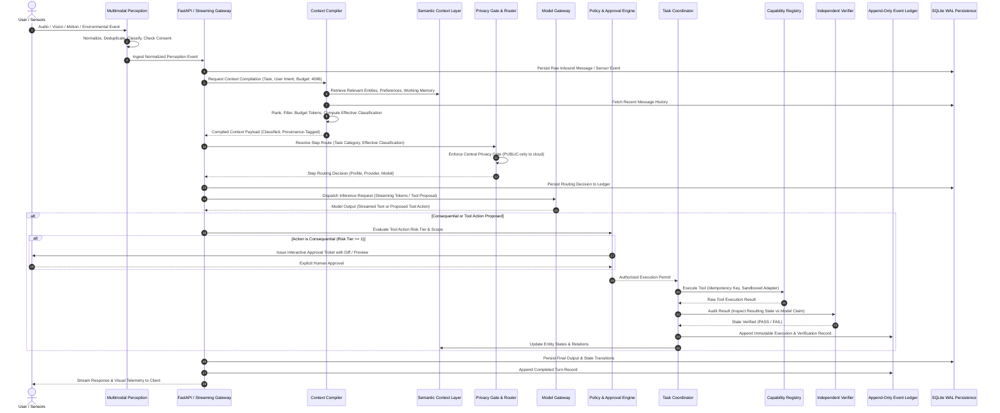

# PICO System Architecture
## Claude Architecture × JARVIS-Class Capabilities × Onix Wingspan 2.0

---

## 1. Executive Summary & Vision

**PICO** (Personal Intelligence Coordinator & Operator) is an original, local-first personal intelligence and execution system. PICO rejects the superficial chatbot-wrapper paradigm. It bridges perception, persistent context, reasoning, deterministic planning, authorized real-world execution, and verifiable auditability.

PICO synthesizes three governing design perspectives:
1. **Claude-Derived Engineering Discipline**: Rigorous separation of concerns, provider-agnostic interfaces, typed context compilation with cryptographic/relational provenance, strict token budgeting, canonical data classification (`PUBLIC`, `INTERNAL`, `SENSITIVE`, `SECRET`), fail-closed security gates, and append-only event ledgering.
2. **Onix Wingspan 2.0 Semantic Context Architecture**: A persistent Semantic Context Layer (Semantic Twin) modeling entities, relationships, workflows, device states, and provenance across personal and engineering domains, allowing coordinated logical workers to act on shared, verified context without hallucinated state.
3. **JARVIS-Class Multimodal Perception & Execution**: First-class multimodal sensory perception (hearing, seeing, movement, environmental telemetry), controlled computer/browser automation, and physical appliance control through Home Assistant, bounded strictly by human-in-the-loop authorization and post-action state verification.

### Core Operating Loop
```
Perceive ──> Understand ──> Retrieve Context ──> Plan ──> Authorize ──> Act ──> Verify ──> Remember
```
- **Read-only queries** conclude cleanly after verification and context update.
- **Consequential or physical actions** must pass through the Policy & Approval Engine, execute through sandboxed adapters with idempotency keys, verify the resulting external state, and append immutable records to the Event Ledger.

---

## 2. Shared Core Architecture & Subsystem Boundaries

PICO maintains two primary operating modes over a unified, shared Core:
- **Personal Assistant**: Long-term conversational continuity, personal memory, reminders, calendar/schedule management, voice interaction, and authorized smart home automation.
- **Engineering Workspace**: Repository comprehension, isolated file and development operations, browser-assisted research, automated testing, diff staging, and git workflow execution.

Both modes share the identical Policy & Approval Engine, Context Compiler, Model Gateway, Memory Services, Task Coordinator, Capability Registry, Independent Verifier, and Event Ledger. Operating in the engineering workspace confers **no privileged bypass** around security, authorization, or audit gates.

```
+-------------------------------------------------------------------------------------------------------------------+
|                                                 EXPERIENCE LAYER                                                  |
|                        Desktop Web UI  |  Voice Push-to-Talk  |  CLI / Local Workspace IPC                        |
+-------------------------------------------------------------------------------------------------------------------+
                                                          |
                                                          v
+-------------------------------------------------------------------------------------------------------------------+
|                                             MULTIMODAL PERCEPTION LAYER                                           |
|       Audio Adapter        |      Vision Adapter       |      Movement Adapter     |    Environmental Sensors     |
|   (Push-to-Talk, STT/TTS)  | (Screenshots, Snapshots)  | (PIR, Frame-Diff, Motion) | (MQTT, ESP32, Home Assistant)|
+-------------------------------------------------------------------------------------------------------------------+
                                                          |
                                             [Normalized Classified Events]
                                                          v
+-------------------------------------------------------------------------------------------------------------------+
|                                                     PICO CORE                                                     |
|                                                                                                                   |
|   +----------------------------+     +-------------------------------+     +----------------------------------+   |
|   |      Context Compiler      |     |   Policy & Approval Engine    |     |      Task Engine Coordinator     |   |
|   |  - Typed Context Items     |     |   - Human-in-the-Loop Tickets |     |   - Stateful Workflow DAGs       |   |
|   |  - Token Budget (4096 ctx) |     |   - Consequential Gatekeeper  |     |   - Checkpoints & Idempotency    |   |
|   |  - Provenance & Ranking    |     |   - Risk Tiers (0, 1, 2, 3)   |     |   - Interruption Recovery        |   |
|   +----------------------------+     +-------------------------------+     +----------------------------------+   |
|                 |                                    |                                       |                    |
|                 v                                    v                                       v                    |
|   +-----------------------------------------------------------------------------------------------------------+   |
|   |                                       Model Gateway & Privacy Router                                      |   |
|   |   - Central Privacy Gate: PUBLIC-only to cloud (requires CLOUD_ENABLED=true); zero private leaks          |   |
|   |   - Profiles: local-small (Qwen 2B), local-mid (Qwen 4B candidate), cloud-strong, embeddings              |   |
|   |   - Deterministic Per-Step Routing: classification severity, task complexity, budget limits               |   |
|   +-----------------------------------------------------------------------------------------------------------+   |
|                 |                                    |                                       |                    |
|                 v                                    v                                       v                    |
|   +----------------------------+     +-------------------------------+     +----------------------------------+   |
|   |    Capability Registry     |     |     Independent Verifier      |     |       Observability & Eval       |   |
|   |  - Strict JSON Schemas     |     |  - Post-Action State Auditor  |     |   - Latency, RAM, VRAM Telemetry |   |
|   |  - Sandboxed Tool Adapters |     |  - Tool Return vs Claim Check |     |   - Golden Eval Suite (50 cases) |   |
|   +----------------------------+     +-------------------------------+     +----------------------------------+   |
+-------------------------------------------------------------------------------------------------------------------+
                                                          |
                                                          v
+-------------------------------------------------------------------------------------------------------------------+
|                                                 PERSISTENCE & STATE                                               |
|                                                                                                                   |
|   +-----------------------------------------------------------------------------------------------------------+   |
|   |                           Semantic Context Layer (Onix Wingspan 2.0 Inspired)                             |   |
|   |   - Entity Graph: Projects, Repos, Files, Devices, Tasks, People, Preferences, Sensor Sources             |   |
|   |   - Grounded Lineage: Relationships backed strictly by verified events or approved sources                |   |
|   +-----------------------------------------------------------------------------------------------------------+   |
|   +-----------------------------------------------------------------------------------------------------------+   |
|   |                                     Four-Part Memory Subsystem                                            |   |
|   |   - Working Memory: Current active task context, conversation state, temporary execution scratchpad       |   |
|   |   - Episodic Memory: Narrative history of interactions, workflow results, time-indexed experiences        |   |
|   |   - Semantic Memory: Approved domain facts, user preferences, entity knowledge (SQLite FTS5 + Vectors)    |   |
|   |   - Procedural Memory: Reusable skills, validated routines, and execution playbooks (Approval Required)   |   |
|   +-----------------------------------------------------------------------------------------------------------+   |
|   +-----------------------------------------------------------------------------------------------------------+   |
|   |                                         Append-Only Event Ledger                                          |   |
|   |   - Write-once immutable audit log: inputs, routing decisions, tool attempts, approvals, state proofs     |   |
|   +-----------------------------------------------------------------------------------------------------------+   |
|   +-----------------------------------------------------------------------------------------------------------+   |
|   |                                  Relational Persistence (SQLite WAL)                                      |   |
|   |   - SQLite 3.12+ (PRAGMA journal_mode=WAL; PRAGMA foreign_keys=ON;), Alembic Migrations, SQLAlchemy 2.0   |   |
|   +-----------------------------------------------------------------------------------------------------------+   |
+-------------------------------------------------------------------------------------------------------------------+
```

---

## 3. End-to-End System Data Flow



---

## 4. Subsystem Specifications

### 4.1 Multimodal Perception Layer (PICO's Senses)
1. **Audio (Hearing & Speaking)**:
   - Push-to-Talk (PTT) input mode as primary, privacy-preserving interface.
   - Local Speech-to-Text (STT) and Text-to-Speech (TTS).
   - Clear visual indicators when microphone input is active.
   - Text chat remains 100% usable when audio subsystem is inactive or disabled.
   - Wake-word detection deferred until explicit resource and privacy benchmarking passes.
2. **Vision (Seeing & Interpreting)**:
   - On-demand screen capture and user-submitted image analysis.
   - On-demand webcam snapshots with explicit user consent and visible status.
   - Scene change detection and optical character recognition (OCR).
   - Cameras are **OFF by default**; frames discarded immediately after processing unless explicit retention is authorized.
   - No covert monitoring, persistent biometric facial recognition, or unauthorized capture.
3. **Movement & Physical Motion**:
   - Ingestion of motion events (PIR sensors, camera frame-differencing).
   - Three distinct capability tiers: (1) Motion Detection, (2) Movement Interpretation, (3) Cross-Modal Interpretation.
   - Confidence scoring and source provenance on all motion inferences; low-confidence detections are never converted into facts.
4. **Environmental & Telemetry Sensors**:
   - Temperature, humidity, ambient light, door/window contacts, air quality, device battery/power telemetry.
   - Gateway adapters for Home Assistant REST/WebSocket, MQTT, and ESP32 nodes.
   - Offline test doubles and mock sensor drivers for complete offline testing.
5. **Sensor Event Normalization & Fusion**:
   - Shared Event Contract:
     ```python
     class NormalizedPerceptionEvent(BaseModel):
         event_id: str
         correlation_id: str
         timestamp: datetime
         modality: str  # audio, vision, motion, environmental
         event_type: str
         source_device_id: str
         data_classification: str  # PUBLIC, INTERNAL, SENSITIVE, SECRET
         confidence: float
         raw_payload_scrubbed: bool
         structured_data: dict[str, Any]
         provenance: str
         retention_policy: str
     ```
   - Deduplication, rate-limiting, and sensor cooldowns. Perception events cannot authorize actions on their own.

### 4.2 Semantic Context Layer (Onix Wingspan 2.0 Reference)
- Inspired by Wingspan's Semantic Twin and shared intelligence fabric.
- Models entities: Projects, Repositories, Files, Tasks, Home Devices, Sensors, User Preferences, Decisions, and Workflows.
- Grounded Lineage: Every entity relationship must link to an explicit event in the Event Ledger or a verified source.
- Three Distinct Responsibilities:
  1. **Semantic Context Layer**: Persistent knowledge graph of entities, states, and relationships.
  2. **Context Compiler**: Request-scoped assembler selecting, budgeting, and classifying information for prompt generation.
  3. **Event Ledger**: Immutable append-only audit trail of what was attempted, approved, executed, and verified.

### 4.3 Context Compiler & Four-Part Memory Subsystem
1. **Context Compiler**:
   - Assembles prompt payloads within a documented conservative budget strategy (`conservative-prompt-budget-v1`).
   - Enforces the provider's actual context limit (default 4096 tokens): reserves `completion_reserve` (512 tokens) and `safety_headroom` (256 tokens), capping the prompt budget ceiling to `max_prompt_budget` (3328 tokens) so that prompt + completion + headroom <= 4096.
   - Model-aware tokenizer selection & conservative upper bound: selects chat template and tokenizer matching the target model (`chatml` for Qwen, `openai_chat` for GPT-4). `is_exact_count=False` for all compiled chat requests because complete provider requests include estimated message-framing overhead; when an exact BPE vocabulary is available (e.g. `tiktoken` for GPT-4), text content is exact while `bound_type='exact_content_estimated_framing'`. For Qwen/Ollama, token footprint is conservatively bounded by UTF-8 byte length (`conservative-utf8-byte-bound-v1`) guaranteeing non-underestimation in byte-fallback BPE tokenizers. ChatML template overhead (5 tokens/envelope + 3 tokens generation prompt) is validated against the active model configuration.
   - Mandatory instruction protection: Mandatory system instructions and privacy/safety rules (`is_mandatory=True` or `role='system'`) are allocated first and cannot be pruned for conversational history. If mandatory rules alone exceed the budget, the compiler fails closed with `ValidationError`.
   - Accepts typed `ContextItem` objects carrying explicit source provenance (`msg:`, `proj:`, `task:`, `system:`, `mem:`) and data classifications.
   - Employs deterministic ranking (System Prompt 100 > Current User Message 90 > Active Task/Project Context 80 > Recent Conversation History 50 > Approved Memory 40).
   - Safe boundary truncation: high-priority items exceeding budget are cleanly truncated at word boundaries with explicit truncation notices; historical turns are pruned turn-by-turn.
   - Enforces fail-closed classification: Payload classification equals the highest sensitivity among included items (`SECRET` > `SENSITIVE` > `INTERNAL` > `PUBLIC`); missing/corrupted tags default to `INTERNAL`.
   - Generates inspectable selection logs recording what was included, truncated, or excluded.
2. **Four-Part Memory**:
   - **Working Memory**: In-flight scratchpad, active task parameters, ephemeral conversation turns.
   - **Episodic Memory**: Time-indexed interaction logs, workflow outcomes, and historical lessons.
   - **Semantic Memory**: Verified user preferences, system configuration, domain facts (SQLite FTS5 keyword indexing initially, vector embeddings added only when justified).
   - **Procedural Memory**: Reusable skills, verified tool sequences, and automated playbooks (requires explicit user approval before activation).

### 4.4 Model Gateway & Privacy Gate
1. **Central Privacy Gate**:
   - **PUBLIC-only Cloud Rule**: Only context payloads whose effective classification is strictly `PUBLIC` may be routed to external cloud models, and only when `CLOUD_ENABLED=true`.
   - **Hard Local Pin**: Any payload containing `INTERNAL`, `SENSITIVE`, `SECRET`, missing, or unknown classifications is strictly pinned to local execution or fails closed.
   - **Zero Secret Leakage**: API keys, bearer tokens, and credentials live exclusively in server-side environment variables and are scrubbed from all prompt assembly, logs, and client responses.
   - **Defense in Depth**: Verification checks exist at the Router, API endpoint, and inside the Cloud Provider adapter itself.
2. **Model Profiles**:
   - `local-small`: Default Ollama model (`qwen3.5:2b`), context window 4096 tokens, `think=False` by default for fast, bounded routine tasks.
   - `local-mid`: Candidate Ollama model (`qwen3.5:4b`), enabled only after benchmark validation on host hardware.
   - `cloud-strong`: Configurable cloud model (OpenAI, Anthropic, Gemini) for deep reasoning on purely `PUBLIC` data.
   - `mock`: Deterministic offline test provider for CI and zero-dependency unit tests.

### 4.5 Tool Execution & Verification Engine (Implemented in Milestone P5)
1. **Explicit Capability Registry**:
   - Capabilities must be registered explicitly in trusted server-side code (`pico.capabilities.registry.registry`). Dynamic execution of arbitrary code, shell commands, or unvetted scripts is strictly prohibited.
   - Declarative metadata per capability: `capability_id`, `version`, `name`, `description`, `risk_tier` (`READ_ONLY`, `LOW`, `MEDIUM`, `HIGH`, `CONSEQUENTIAL`), `required_permission`, `required_classification`, `timeout_seconds`, `max_output_bytes`, `idempotent`, `consequential`.
   - Initial safe capabilities: `core.calculator` (bounded AST arithmetic), `core.validate_json` (syntax & key validator), `db.read_project` / `db.read_task` (read-only SQLite repository access), `system.diagnostics` (deterministic health and connection check), and test capabilities.
2. **Task Execution State Machine**:
   - Documented lifecycle transitions: `queued -> running -> verifying -> succeeded`, with error/recovery states: `awaiting_approval`, `failed`, `cancelled`, `timed_out`, `verification_failed`, `retry_scheduled`.
   - Database transactions for all state transitions, surviving engine disposal and system crashes.
   - Crash Recovery: Startup hook (`ToolExecutionEngine.recover_interrupted_executions()`) scans for executions left in `running` or `verifying` states across application restart and marks them as `failed` with explicit crash recovery notes.
3. **Idempotency, Deadlines & Cooperative Cancellation**:
   - Unique `idempotency_key` enforcement at submission time; duplicate submissions return existing execution records without re-execution.
   - Strict deadline tracking with configurable `timeout_seconds` enforced via `asyncio.wait_for`.
   - Cooperative cancellation supported for `queued` and `awaiting_approval` tickets.
4. **Independent Deterministic Verification**:
   - Independent verification stage executed after capability handler completion.
   - Verifies returned payload against output schema, verifies mathematical or state consistency independently, and validates execution evidence.
   - Verifier failure marks execution as `verification_failed` — an execution is never marked successful merely because its handler did not throw an exception.
5. **Trusted Authorization & Human Approval**:
   - Consequential capabilities strictly require human approval bound to an immutable SHA-256 `input_digest`.
   - Tampered input parameters invalidate existing approval tickets.
   - Approval identity is verified against server-side trusted identities (`settings.TRUSTED_APPROVER_IDENTITIES`) and token (`X-Pico-Approval-Token`). Model-generated strings or untrusted callers cannot authorize actions.
6. **Append-Only Event Ledger**:
   - Write-once audit log (`event_ledger`) tracking all lifecycle events (`task_submitted`, `execution_started`, `verification_passed`, etc.).
   - Automatic recursive credential and secret scrubbing (`api_key`, `token`, `secret`, `password`, `authorization`).
7. **Procedural Memory Integration**:
   - Procedure validation (`/api/tools/procedures/{id}/validate`) checks each procedure step against the Capability Registry, verifying capability availability and flagging required approval tickets without allowing procedures to self-activate.


### 4.6 Computer Control & Engineering Workspace
- Controlled OS automation: application launch, window inspection, file reading/writing via staged diffs.
- Sandboxed Browser Automation via Playwright: isolated browser profile, treats web content as untrusted untrusted data, requires confirmation before form submission, transaction, or communication.
- Safe Filesystem Operations: Diff preview, reversible writes, strict directory boundary enforcement.

### 4.7 Home Automation & Physical Actuation (Home Assistant)
- Home Assistant REST/WebSocket API as the sole integration hub.
- Phased Progression:
  - **Stage A (Read-Only Awareness)**: Discover entities, inspect states, report sensor readings without mutating state.
  - **Stage B (First End-to-End Control)**: Harmless single light toggle through the complete loop (Intent -> Context -> Plan -> Approval -> Act -> State Verification -> Event Ledger).
  - **Stage C (Everyday Appliances)**: Authorized lights, switches, smart plugs.
  - **Stage D (Complex Household Control)**: Scenes, thermostats, climate controls with physical consequence modeling.
- Security-sensitive actuators (door locks, security systems) remain **NOTIFY-ONLY** / blocked under current policy.

### 4.8 Independent Verifier & Event Ledger
- Independent Verifier audits post-action state directly from external systems (e.g. filesystem check, API return, Home Assistant entity state) rather than trusting model narration.
- Append-Only Event Ledger persists immutable audit events with timestamps, correlation IDs, input parameters, approval tickets, and verification proofs.

---

## 5. Host Hardware & Resource Constraints

Target Environment:
- **CPU**: Intel Core i5-13420H (8 cores / 12 threads)
- **RAM**: 16 GB DDR5 System RAM
- **GPU**: NVIDIA GeForce RTX 3050 Laptop GPU (4 GB dedicated VRAM)
- **Disk**: ~60 GB available storage
- **Host OS**: Windows 11 with PowerShell

### Non-Negotiable Resource Invariants
1. **Single Model Residency**: At most one inference model resident in GPU VRAM/RAM at any time. Simultaneous chat and embedding model residency is prohibited until formal benchmark headroom is proven.
2. **No Oversized Models**: 70B+ or 125B+ models are strictly out of scope for the local host hardware.
3. **Context Limit**: Active local model context window is strictly bounded to 4096 tokens (8192 tested only under measured telemetry).
4. **Graceful Degradation**: Core persistence, local task management, and deterministic workflows remain 100% operational when Ollama or internet connectivity is unavailable.

---

## 6. Comprehensive Capability Matrix / Inventory

| Capability ID | Capability Name | Purpose | Subsystem / Layer | Dependencies | Risk Tier | Data Classification | Required Hardware / Integration | Current Evidence | Implementation Status | Acceptance Criteria |
|---|---|---|---|---|---|---|---|---|---|---|
| **CAP-CORE-01** | Core Persistence Engine | Relational storage for conversations, messages, projects, tasks | Persistence | SQLite WAL, SQLAlchemy 2.0 | Tier 0 (Read/Internal) | `INTERNAL` | Host Filesystem | `tests/test_conversations.py`, `tests/test_messages.py`, `tests/test_persistence_reopen.py` | **VERIFIED** | Clean schema migrations, foreign keys enabled, WAL mode active, zero data corruption on restart. |
| **CAP-MOD-01** | Provider-Agnostic Gateway | Abstract interface for local & cloud LLMs | Model Gateway | `pico.providers.base` | Tier 0 (Read) | `PUBLIC` to `SECRET` | Python runtime | `tests/test_mock_provider.py` | **VERIFIED** | Supports streaming, cancellation, metadata, typed error hierarchies. |
| **CAP-MOD-02** | Local Ollama Provider | Fast local private inference (`qwen3.5:2b`) | Model Gateway | Ollama daemon | Tier 0 (Compute) | `PUBLIC` to `SECRET` | Host CPU / RTX 3050 | `tests/test_ollama_provider.py` | **VERIFIED** | Async NDJSON streaming, 4096 context window, explicit `think` precedence contract. |
| **CAP-MOD-03** | Configurable Cloud Provider | Strong reasoning for eligible public tasks | Model Gateway | OpenAI-compatible endpoint | Tier 1 (External egress) | `PUBLIC` strictly | Internet connectivity | `tests/test_cloud_provider.py` | **VERIFIED** | Opt-in via `CLOUD_ENABLED=true`, zero canary secret leakage, defense-in-depth non-PUBLIC rejection. |
| **CAP-SEC-01** | Central Privacy Gate | Deterministic enforcement of data routing policy | Security / Router | `pico.services.routing_service` | Tier 0 (Gatekeeper) | All | None | `tests/test_routing_service.py`, `tests/test_chat_stream_api.py` | **VERIFIED** | Only PUBLIC context reaches cloud; effective context sensitivity computation; hard local pin for private data. |
| **CAP-TEL-01** | Hardware Benchmark Runner | Telemetry harness for TTFT, tok/s, RAM, VRAM | Observability | `tools/bench/` | Tier 0 (Diagnostics) | `INTERNAL` | Windows kernel32, nvidia-smi | `tests/test_bench_runner.py`, `tests/test_automation_scripts.py` | **VERIFIED** | Preflight checks, zero automatic model downloads, synthetic benchmark prompts, JSON/MD reporting. |
| **CAP-CTX-01** | Context Compiler v0 | Typed context assembly, token budgeting & provenance | Context / Memory | `pico.services.context_compiler` | Tier 0 (Compute) | All | None | `pico/services/context_compiler.py`, `tests/test_context_compiler.py` | **VERIFIED (P2)** | 4096-token budget enforced via conservative budget strategy (3328 prompt ceiling, 512 completion reserve, 256 headroom), conservative BPE upper-bound, fail-closed classification, provenance tags, inspectable decisions. |
| **CAP-MEM-01** | Four-Part Memory Service | Working, episodic, semantic, and procedural knowledge | Memory | SQLite FTS5, Context Compiler | Tier 0 (Storage) | `INTERNAL` / `SENSITIVE` | SQLite | Documented spec in `docs/architecture.md` | **PLANNED (P4)** | Memory items carry provenance and approval status; proposed vs approved facts separated; FTS5 search. |
| **CAP-TSK-01** | Stateful Task Engine | Persistent multi-step execution coordinator | Task Engine | SQLite, Context Compiler | Tier 1 (Execution) | `INTERNAL` | SQLite | Documented spec in `docs/architecture.md` | **PLANNED (P5)** | Persistent DAG states, idempotency keys, interrupt recovery, bounded retries. |
| **CAP-TOOL-01**| Capability Registry | Sandboxed tool allowlist with strict JSON schemas | Tools / Execution | Pydantic v2, Task Engine | Tier 1 (Execution) | Scoped | Host OS | Documented spec in `docs/architecture.md` | **PLANNED (P5)** | Schema validation on all proposals, least-privilege scoping, clear error envelopes. |
| **CAP-POL-01** | Policy & Approval Engine | Human-in-the-loop gatekeeper for consequential actions | Security | Capability Registry | Tier 0 (Gatekeeper) | All | Experience Layer | Documented spec in `docs/security-and-risk-register.md` | **PLANNED (P5)** | Interactive approval ticket with diff display for consequential writes/deletions/transfers. |
| **CAP-AUD-01** | Append-Only Event Ledger | Immutable audit trail for all inputs, actions, proofs | Auditability | SQLite, Task Engine | Tier 0 (Audit) | All | SQLite | Documented spec in `docs/data-model.md` | **PLANNED (P5)** | Write-once append-only log, cryptographic hash chains, deterministic replay for debugging. |
| **CAP-PER-01** | Push-to-Talk Voice Interface | Local voice input and transcription | Perception | Local STT, Audio capture | Tier 1 (Sensor) | `SENSITIVE` | Host Microphone | Documented spec in `docs/architecture.md` | **PLANNED (P6)** | Explicit PTT activation, visible mic active indicator, local-only transcription, instant cancel. |
| **CAP-PER-02** | Visual Inspection Adapter | User-requested screenshots & camera snapshots | Perception | Screen capture, OpenCV/Camera | Tier 1 (Sensor) | `SENSITIVE` | Host Display, Webcam | Documented spec in `docs/architecture.md` | **PLANNED (P6)** | Cameras off by default, temporary frames discarded post-inference, explicit capture trigger. |
| **CAP-PER-03** | Movement & Motion Sensor | Motion event ingestion and change detection | Perception | Camera diffing, PIR sensor | Tier 1 (Sensor) | `INTERNAL` | Host Camera / PIR Hub | Documented spec in `docs/architecture.md` | **PLANNED (P6)** | Confidence-rated motion events, event normalization, cooldown deduplication, zero covert tracking. |
| **CAP-PER-04** | Environmental Telemetry | Sensor ingestion for temperature, light, presence | Perception | MQTT / Home Assistant API | Tier 0 (Ingest) | `INTERNAL` | Sensor network / Hub | Documented spec in `docs/architecture.md` | **PLANNED (P6)** | Normalized sensor contracts, offline test doubles, rate limiting. |
| **CAP-HA-01**  | Home Assistant Appliance Control | Physical smart home awareness and actuation | Physical World | Home Assistant API | Tier 2 (Actuation) | `INTERNAL` | Home Assistant Hub | Documented spec in `docs/architecture.md` | **PLANNED (P7)** | Stage A (read-only) -> Stage B (verified light toggle) -> Stage C (switches/plugs) -> Stage D (climate). High-impact security controls blocked. |
| **CAP-PC-01**  | Computer & Workspace Control | Sandboxed application, window, and file automation | Workspace | OS accessibility, Playwright | Tier 2 (Automation) | `INTERNAL` / `SENSITIVE` | Host OS | Documented spec in `docs/architecture.md` | **PLANNED (P8)** | Reversible staged diffs, isolated browser profile, untrusted web content isolation, verification before success claims. |
| **CAP-AGT-01** | Multi-Agent Coordination | Subtask delegation over Task Engine | Coordination | Task Engine, Single Model | Tier 1 (Orchestration)| All | Host CPU / GPU | Documented spec in `docs/architecture.md` | **PLANNED (P9)** | Logical workers scheduled over single resident model, independent verification of worker outputs. |
| **CAP-EXP-01** | Unified PICO Experience | Real-time web UI, streaming chat, approval cards | Experience Layer | FastAPI, SSE, Web frontend | Tier 0 (Presentation) | All | Modern Browser | Documented spec in `docs/api-contract.md` | **PLANNED (P10)**| Streaming chat, voice toggle, sensor indicators, memory inspection, approval interaction, offline resilience. |

---

## 7. Canonical Implementation Roadmap (P0–P10)

### Milestone P0: Architecture & Repository Baseline
- Inventory codebase, schemas, tests, and documentation.
- Establish canonical architecture record, data model contracts, and capability inventory.
- *Status*: **VERIFIED & MAINTAINED**.

### Milestone B1: Think-Behavior Reliability
- Implement and verify Ollama `think` parameter precedence: `GenerationOptions.think` -> Provider default (`think=False`) -> Omitted.
- Test actual outbound provider payload serialization across all boolean and omitted combinations.
- *Status*: **VERIFIED** (`tests/test_ollama_provider.py`).

### Milestone P1: Central Privacy Gate & Context Sensitivity
- Enforce strict PUBLIC-only cloud inference rule (`CLOUD_ENABLED=true` required).
- Compute effective classification across all assembled context items (`SECRET` > `SENSITIVE` > `INTERNAL` > `PUBLIC`).
- Hard local pin for non-PUBLIC context (`RULE_PRIVATE_LOCAL_PIN`).
- Defense-in-depth security verification in Cloud provider adapter and chat streaming endpoints.
- *Status*: **VERIFIED** (`tests/test_routing_service.py`, `tests/test_chat_stream_api.py`, `tests/test_cloud_provider.py`).

### Milestone P2: Context Compiler v0
- Accept typed `ContextItem` inputs with explicit source provenance and data classifications.
- Enforce documented 4096-token budget using calibrated `heuristic-char-word-v1` counter.
- Deterministic ranking: System Prompt > Current User Turn > Active Task Context > Recent History > Memory.
- Fail-closed sensitivity computation: Payload sensitivity equals highest severity item; invalid classifications default to `INTERNAL`.
- Full inspectable selection logs (included, truncated, excluded decisions with reasons).
- Integrated into `POST /api/chat/stream` pipeline.
- *Status*: **ACTIVE / IMPLEMENTATION TARGET**.

### Milestone P3: Hardware Benchmarks & Quality Gates
- Execute multi-repetition benchmark suite measuring TTFT, tokens/sec, RAM, and VRAM.
- Measure available `qwen3.5:2b` baseline and evaluate proposed `qwen3.5:4b` under single-model residency.
- Preflight availability gate preventing unreviewed model downloads.
- Machine-readable benchmark reports in `bench_reports/`.
- *Status*: **FOUNDATION BUILT (`tools/bench/`), PENDING P2 COMPLETION**.

### Milestone P4: Memory v1 (Four-Part Subsystem)
- Implement Working, Episodic, Semantic, and Procedural memory stores.
- SQLite FTS5 search and retrieval for semantic memory.
- Provenance tags and distinction between proposed facts and human-approved knowledge.
- *Status*: **PLANNED**.

### Milestone P5: Task Engine, Capability Registry & Event Ledger
- Persistent stateful workflow coordinator with DAG execution.
- Sandboxed capability registry with strict JSON schema validation.
- Policy & Approval Engine with interactive approval tickets for consequential actions.
- Append-only Event Ledger with idempotency keys and replay capability.
- *Status*: **PLANNED**.

### Milestone P6: Multimodal Perception Layer
- Push-to-Talk voice adapter with local STT/TTS and visible indicators.
- On-demand screen and camera capture with instant frame disposal.
- Motion event detection and environmental sensor ingestion (MQTT/Home Assistant).
- Normalized sensor event fusion framework.
- *Status*: **PLANNED**.

### Milestone P7: Home Automation & Physical Actuation
- Home Assistant REST/WebSocket integration hub.
- Stage A (Read-only awareness) -> Stage B (Verified light toggle) -> Stage C (Switches/plugs) -> Stage D (Climate).
- Post-action state verification and Event Ledger recording.
- *Status*: **PLANNED**.

### Milestone P8: Computer Control & Engineering Workspace
- Sandboxed desktop application and window inspection.
- Staged filesystem diffs with human-in-the-loop review.
- Sandboxed Playwright browser automation with untrusted web content isolation.
- *Status*: **PLANNED**.

### Milestone P9: Workflow Planning & Multi-Agent Coordination
- Multi-step planning over Task Engine.
- Logical specialist workers scheduled over single resident model.
- Independent verification of worker outputs before dependent tasks proceed.
- *Status*: **PLANNED**.

### Milestone P10: Unified PICO Experience
- Comprehensive desktop web application with streaming chat, voice interaction, memory editor, task timeline, approval tickets, and device control cards.
- Full offline degradation resilience.
- *Status*: **PLANNED**.
