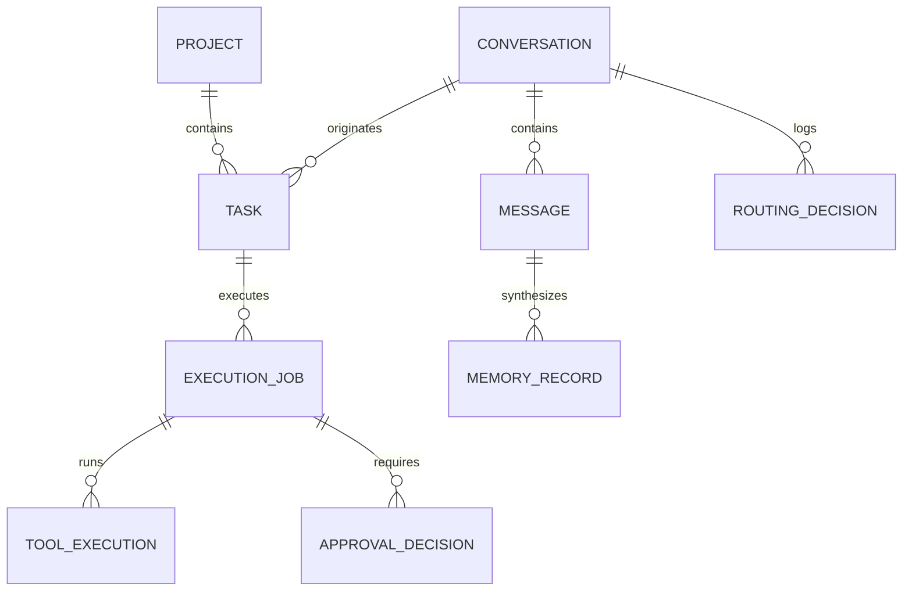

# PICO Data Model Specification

## 1. Schema Design Philosophy

The PICO persistence architecture is designed around four foundational constraints:
1. **Local-First Reliability**: SQLite with WAL mode (`PRAGMA journal_mode = WAL`) and immediate foreign-key enforcement (`PRAGMA foreign_keys = ON`) as the primary local persistence engine.
2. **PostgreSQL Migration Parity**: Standard relational modeling using SQLAlchemy 2.0 and Alembic. Database-agnostic column types (e.g., standard UTC ISO8601 strings or DateTime, JSON payload columns, UUID/prefixed text primary keys) guarantee zero-friction migration to PostgreSQL.
3. **Auditability & Append-Only Foundations**: Mutable operational entities (Conversations, Tasks, Projects) are clearly separated from immutable append-only records (Event Ledger, Routing Decisions, Tool Executions).
4. **Data Classification & Provenance**: Core data models support explicit classification levels (`PUBLIC`, `INTERNAL`, `SENSITIVE`, `SECRET`) and relational provenance links.

---

## 2. Entity Relationship Overview

---

## 3. Active Implementation Entities (Phase 1, Slice 1)

### 3.1 `conversations`
Represents an ongoing interaction context or inquiry thread.

| Column | Type | Constraints | Description |
|---|---|---|---|
| `id` | VARCHAR(64) | PRIMARY KEY | Stable prefixed identifier (`conv_<uuid>` or UUID) |
| `title` | VARCHAR(255) | NOT NULL | Human-readable conversational title |
| `created_at` | VARCHAR(32) / DATETIME | NOT NULL | UTC timestamp (ISO 8601) |
| `updated_at` | VARCHAR(32) / DATETIME | NOT NULL | UTC timestamp (ISO 8601) |
| `metadata_json` | TEXT | NULLABLE | Extensible JSON object for tags, client info, state flags |

- **Indexes**: `idx_conversations_updated_at` (for fast descending list ordering).
- **Deletion Behavior**: CASCADE deletes child messages.

---

### 3.2 `messages`
Represents an immutable turn within a conversation (user input, assistant output, or system notice).

| Column | Type | Constraints | Description |
|---|---|---|---|
| `id` | VARCHAR(64) | PRIMARY KEY | Stable prefixed identifier (`msg_<uuid>` or UUID) |
| `conversation_id` | VARCHAR(64) | NOT NULL, FK -> `conversations.id` ON DELETE CASCADE | Parent conversation reference |
| `role` | VARCHAR(32) | NOT NULL | One of: `user`, `assistant`, `system`, `tool` |
| `content` | TEXT | NOT NULL | Text payload of the message |
| `data_classification`| VARCHAR(32) | NOT NULL, DEFAULT `'INTERNAL'` | `PUBLIC`, `INTERNAL`, `SENSITIVE`, `SECRET` |
| `token_count` | INTEGER | NULLABLE | Calculated or observed token length |
| `created_at` | VARCHAR(32) / DATETIME | NOT NULL | UTC timestamp (ISO 8601) |
| `metadata_json` | TEXT | NULLABLE | Extensible JSON object (model profile, finish reason, tool calls) |

- **Indexes**: `idx_messages_conversation_created` (`conversation_id`, `created_at ASC`).
- **Invariants**: `conversation_id` must reference an existing `conversations` record; foreign keys strictly enforced. In Slice 1, persisting a user message does not fabricate an assistant message.

---

### 3.3 `projects`
Represents a user goal or persistent workspace grouping tasks, context, and documentation.

| Column | Type | Constraints | Description |
|---|---|---|---|
| `id` | VARCHAR(64) | PRIMARY KEY | Stable prefixed identifier (`proj_<uuid>` or UUID) |
| `name` | VARCHAR(255) | NOT NULL | Unique project name |
| `description` | TEXT | NULLABLE | Extended scope or objective description |
| `status` | VARCHAR(32) | NOT NULL, DEFAULT `'active'` | `active`, `archived`, `completed` |
| `created_at` | VARCHAR(32) / DATETIME | NOT NULL | UTC timestamp (ISO 8601) |
| `updated_at` | VARCHAR(32) / DATETIME | NOT NULL | UTC timestamp (ISO 8601) |
| `metadata_json` | TEXT | NULLABLE | Extensible JSON object |

- **Indexes**: `idx_projects_status`, `idx_projects_updated_at`.
- **Uniqueness**: `name` unique across active projects.
- **Deletion Behavior**: RESTRICT or SET NULL on associated tasks to prevent accidental orphan purges.

---

### 3.4 `tasks`
Represents an actionable unit of work, either linked to a project, originated from a conversation, or standalone.

| Column | Type | Constraints | Description |
|---|---|---|---|
| `id` | VARCHAR(64) | PRIMARY KEY | Stable prefixed identifier (`task_<uuid>` or UUID) |
| `project_id` | VARCHAR(64) | NULLABLE, FK -> `projects.id` ON DELETE SET NULL | Optional parent project |
| `conversation_id`| VARCHAR(64) | NULLABLE, FK -> `conversations.id` ON DELETE SET NULL | Optional originating conversation |
| `title` | VARCHAR(255) | NOT NULL | Descriptive task summary |
| `description` | TEXT | NULLABLE | Detailed instructions, constraints, or checklist |
| `status` | VARCHAR(32) | NOT NULL, DEFAULT `'pending'` | `pending`, `in_progress`, `completed`, `cancelled` |
| `priority` | VARCHAR(32) | NOT NULL, DEFAULT `'medium'` | `low`, `medium`, `high`, `urgent` |
| `due_date` | VARCHAR(32) / DATETIME | NULLABLE | Optional target completion UTC ISO 8601 |
| `completed_at`| VARCHAR(32) / DATETIME | NULLABLE | Timestamp when marked completed |
| `created_at` | VARCHAR(32) / DATETIME | NOT NULL | UTC timestamp (ISO 8601) |
| `updated_at` | VARCHAR(32) / DATETIME | NOT NULL | UTC timestamp (ISO 8601) |
| `metadata_json` | TEXT | NULLABLE | Extensible JSON object |

- **Indexes**: `idx_tasks_project_id`, `idx_tasks_status`, `idx_tasks_updated_at`.
- **State Invariants**: When `status` changes to `'completed'`, `completed_at` is automatically stamped with the current UTC timestamp. If reverted to `'pending'` or `'in_progress'`, `completed_at` is cleared to `NULL`.

---

## 4. Planned Schema Evolution (Phase 2+)

The following entities are planned for subsequent phases and do NOT form part of Slice 1 physical tables.

### 4.1 `memory_records` (Phase 2)
- Stores synthesized working, episodic, semantic, and procedural memories.
- Schema: `id`, `memory_type` (`WORKING`, `EPISODIC`, `SEMANTIC`, `PROCEDURAL`), `content`, `embedding_vector` (BLOB/Array), `embedding_model`, `provenance_id` (source message or file), `data_classification`, `importance_score`, `decay_factor`, `access_count`, `last_accessed_at`, `created_at`.

### 4.2 `routing_decisions` (Phase 1, Slice 2)
- Inspectable audit log of every model selection decision.
- Schema: `id`, `conversation_id`, `step_index`, `task_category`, `data_classification`, `selected_profile`, `model_name`, `provider`, `decision_rule`, `cloud_approved` (BOOL), `fallback_occurred` (BOOL), `prompt_tokens`, `completion_tokens`, `latency_ms`, `estimated_cost_cents`, `created_at`.

### 4.3 `execution_jobs` & `job_dependencies` (Phase 2)
- Orchestrates multi-step DAG task plans.
- Schema: `id`, `task_id`, `status` (`QUEUED`, `RUNNING`, `WAITING_APPROVAL`, `COMPLETED`, `FAILED`), `plan_dag_json`, `current_step_index`, `created_at`, `updated_at`.

### 4.4 `tool_executions` (Phase 2)
- Audited record of tool invocations with idempotency keys.
- Schema: `id`, `job_id`, `tool_name`, `idempotency_key` (UNIQUE), `parameters_hash`, `parameters_json`, `output_payload`, `is_error` (BOOL), `duration_ms`, `executed_at`.

### 4.5 `approval_decisions` (Phase 2)
- Human-in-the-loop audit trail for consequential operations.
- Schema: `id`, `tool_execution_id`, `action_type`, `risk_level`, `status` (`PENDING`, `APPROVED`, `REJECTED`), `reason`, `requested_at`, `decided_at`, `decided_by`.

### 4.6 `event_ledger` (Phase 2)
- Append-only immutable log for system replay.
- Schema: `sequence_id` (BIGINT AUTOINCREMENT), `event_id` (UUID), `event_type`, `aggregate_type`, `aggregate_id`, `payload_json`, `prev_hash`, `event_hash`, `timestamp`.

### 4.7 `eval_cases` & `eval_runs` (Phase 1, Slice 3 & Phase 3)
- Version-controlled benchmark suites and performance scores.
- Schema: `id`, `suite_name`, `case_name`, `model_profile`, `prompt_tokens`, `latency_ms`, `ram_peak_mb`, `vram_peak_mb`, `score`, `pass_fail` (BOOL), `error_reason`, `run_timestamp`.
