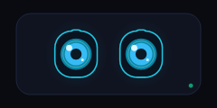
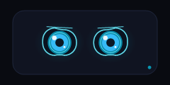
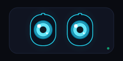

# PICO — Native Expressive Eyes: EMO-Inspired Visual Evolution (P11.2.4.3)

**Date:** 2026-11-17  
**Status:** Completed & Verified  
**Component:** Native Desktop Companion (`frontend/src-tauri/src/companion_render.rs`)  
**Visual Reference:** [EMO Robot Eye Animation (Satya Badiger / LivingAI Emo)](https://youtu.be/pQeTcOIVzHc?si=ijwcRWu1DcZue1qz)  
**Parent Decision:** [ADR 0004: Native Idle Companion & Deferred Command Center](file:///c:/Users/AYUSH/OneDrive/Desktop/PICO/docs/decisions/0004-native-idle-companion-and-deferred-command-center.md)  

---

## 1. Executive Summary

Milestone P11.2.4.3 evolves PICO's existing native Windows desktop companion eyes from rigid capsule status indicators into an expressive, character-like animated eye system inspired by EMO robotics. 

The implementation preserves 100% of PICO's architecture:
1. **Zero Chromium Overhead**: Pure native Win32 GDI+ double-buffered vector rendering on the native companion HWND (`SetWindowSubclass` `0x5049_434F_4559`).
2. **Strict Hardware Budget**: Preserves the `< 100 MB` idle Working Set budget (measured `32.52 MiB` idle). Zero GPU or heavy model dependencies.
3. **Zero Continuous 60 FPS Polling**: Purely event-driven with discrete one-shot Win32 timers, completely suspended when minimized or hidden.
4. **Authoritative State Truthfulness**: Backend supervisor lifecycle states (`Unmanaged`, `Starting`, `Verifying`, `Online`, `Offline`) remain authoritative. No fabricated cognitive modes (`Listening`, `Thinking`, `Speaking`, `Executing`) are injected into the supervisor.
5. **Presentation Expression Engine**: Character moods (`Neutral`, `Attentive`, `Focused`, `Thinking`, `Curious`, `Happy`, `Confused`, `Concerned`, `Resting`, `WakingUp`) are mapped deterministically from real lifecycle states, ambient idle micro-expressions, and direct interactive touch events.

---

## 2. Visual & Geometric Evolution

### A. Eyelid Curvature & Dynamic Squircle Contour
Previously, PICO's eyes were drawn as rigid rounded rectangles (`create_rounded_rect_path`).
With `GdipAddPathBezier` and `GdipAddPathLine` integrated into the native GDI+ pipeline, eye aperture geometry is computed as a dynamically tensioned continuous vector spline:
- **Upper Eyelid Dome**: Smooth Bézier arch varying from relaxed dome (`upper_arch: +0.12`), wide curious curve (`+0.20`), to determined focus compression (`-0.06`).
- **Lower Eyelid Cheek Lift**: Lower eyelid curves upward into the eye aperture (`cheek_lift: +0.60`), creating EMO's signature smiling crescent eyes in `Happy` mode.
- **Brow Slant**: Inward angle for determined concentration (`Focused`, `brow_slant: +0.16`), outer droop for distress/warning (`Concerned`, `brow_slant: -0.20`).
- **Subtle Asymmetry**: In `Curious` mode, the left eye widens and raises its brow while the right eye slightly squinches, producing a lifelike inquisitive head-tilt expression. In `Confused` mode, the eyebrows adopt opposing angles.

### B. Natural Blinking & Double-Blink Mechanics
- **Curved Sweep**: Eyelids descend with natural ease-in toward a realistic waterline just below center.
- **Elastic Rebound**: Eyelids reopen with a slight elastic overshoot before settling to resting aperture.
- **Natural Double-Blinking**: Every 4th blink cycle automatically triggers a natural double-blink (primary closure followed by an immediate lighter secondary flutter), mimicking authentic biological and robotic cadence.

### C. Natural Saccades & Idle Variations
Rather than static positions, `Online` state ambient gaze cycles across 8 discrete micro-positions (`CALM_GAZE_OFFSETS`):
- Calm center (`(0.0, 0.0)`)
- Gentle glance right (`(0.12, -0.02)`)
- Attentive forward (`(0.0, -0.03)`)
- Thoughtful glance up-left (`(-0.14, -0.10)`)
- Curious glance up-right (`(0.15, -0.08)`)

### D. Tactile Interactive Feedback
On mouse-down (`WM_LBUTTONDOWN`) on the companion window:
- The presentation layer immediately enters `Happy` mood: eyes light up into joyful smiling crescents with an additional third starburst catchlight glint.
- On mouse release (`WM_LBUTTONUP`), reaction clears and the Command Center is opened or focused, providing immediate tactile acknowledgement on the Windows desktop.

---

## 3. Visual Gallery & Evidence

All visual evidence is rendered offscreen using native Windows GDI+ vector routines and verified through automated test suites:

| Mood / State | Rendered Preview | Description |
|---|---|---|
| **01. Neutral (Idle Online)** |  | Calm, relaxed squircle aperture with balanced cyan rim and dual specular catchlights. |
| **02. Natural Blink** |  | Curved eyelid sweep closing down across the iris toward the natural waterline. |
| **03. Focused (Verifying)** |  | Narrowed aperture with inward brow slant, determined gaze, and rhythmic precision ring. |
| **04. Waking Up (Starting)** |  | Drowsy slit smoothly opening into alert eyes across process startup steps. |
| **05. Curious** |  | Playful asymmetry: raised arched left eye, slightly squinched right eye, glance shifted up-right. |
| **06. Attentive** |  | Expanded aperture (+10% height), forward gaze, luminous catchlight sparkle. |
| **07. Happy (Interactive)** |  | Smiling crescent eyes with cheek pushed up into iris + extra cheerful starburst glint. |
| **08. Confused** |  | Opposing brow tilts communicating an inquisitive quizzical glance. |
| **09. Concerned (Error)** |  | Drooping outer eyelid contour with warm amber warning palette (`0xF59E0B`). |
| **10. Resting (Sleeping)** |  | Peaceful closed downward-curved sleeping eyelids with subdued resting cyan glow. |

---

## 4. Automated Verification Results

All 13 unit tests passed with 0 warnings:
```
running 13 tests
test companion_render::tests::test_all_expression_palettes_valid_and_distinct ... ok
test companion_render::tests::test_blink_timeline_and_timer_suspension ... ok
test companion_render::tests::test_blink_intervals_within_bounds_and_non_identical ... ok
test companion_render::tests::test_dpi_scaling_and_symmetrical_eye_geometry_bounds ... ok
test companion_render::tests::test_starting_transition_stops_ambient_timer_after_opening ... ok
test companion_render::tests::test_effective_expression_mapping_and_interaction ... ok
test companion_render::tests::test_emo_contour_parameters_and_asymmetry ... ok
test companion_render::tests::test_emo_double_blink_lifecycle ... ok
test companion_render::tests::test_expression_mapping_preserves_truthful_authoritative_state ... ok
test companion_render::tests::test_gaze_saccade_bounds_and_coverage ... ok
test companion_render::tests::test_palette_and_coordinator_lifecycle_guards ... ok
test companion_render::tests::test_resting_and_error_states_schedule_zero_timers ... ok
test companion_render::tests::test_render_and_export_all_expression_screenshots ... ok

test result: ok. 13 passed; 0 failed; 0 ignored; 0 measured; 60 filtered out; finished in 0.16s
```
